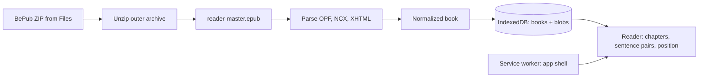

# DuoReader — design brief

**Status:** M3 verified on device: finished one whole book in airplane mode, after the persistence request, import error handling, source-only fallback, lazy images, and parser/position/storage tests. Reader font picker shipped in 0.4.0 from an editable catalog in `src/reader/fonts.json`. System theme shipped in 0.5.0 and is now the default; verified on device on 2026-11-14: flipping the system appearance repaints the app, and stored Light/Sepia/Dark choices ignore the flip. Version 0.12.0: pinyin as an optional source-side line (§18). 0.12.1 keeps a long library title inside its card and bounds the card buttons. Page mode postponed: scroll mode reads well. Sentence and paragraph display modes shipped in 0.6.0 (§18): a `Display` row in the `Aa` sheet, paragraphs stacked on phones and side by side once the reading column reaches 40rem; inline runs (italics, bold, line breaks) followed in 0.7.0; hide-translation and language order followed in 0.8.0, and the `Languages` row gained `Translation only` in 0.9.0; 0.9.1 splits wrapped paragraph containers into separate blocks (found with the Vietnamese sample), verified on device on 2026-11-16: after re-importing the ZIP the front matter shows the title, author, genre, star, and site lines as separate paragraphs. 0.10.0 splits text-only content at HTML block elements, so a plain untranslated EPUB renders paragraph by paragraph instead of one fused block per container, and its `i`/`b`/`br` markup and inline images survive (verified against plain German and Vietnamese EPUBs). 0.10.1 merges a chapter half that the NCX omits into the chapter it continues, instead of numbering it out of place. 0.11.0 moves the chapter list from the top-bar select into a sheet, so the reading screen names no chapter and a chapter's own heading is never repeated next to it; §19 states the storage contract (settings global, positions resolved by pair id) and `tests/e2e/state-contract.spec.ts` pins it; 0.11.1 retries the settings read and drops a rejected database open, so a transient IndexedDB failure no longer paints defaults over a stored record. Next: the learning layer, planned in `LEARNING.md` (see §17), starting with the annotations core.
**Date:** 2026-11-16

Repo map, commands, invariants, and agent instructions: **`AGENTS.md`**. BePub archive format: **`DATA-FORMAT.md`**. Learning layer: **`LEARNING.md`**.

## 1. Summary

DuoReader is a personal, offline-first reader for BePub bilingual exports. It imports the BePub ZIP, reads `reader-master.epub`, and displays the book as source/translation sentence pairs: source leading, translation smaller and dimmed underneath. It runs as an installable PWA on iPad and iPhone, stores books and reading positions on-device, and works in airplane mode after the first load.

Success is concrete: **finish one whole book on the iPad, offline, without losing the reading position.**

## 2. Goals and success criteria

- Import a BePub ZIP from the iOS Files picker; keep several books on a shelf.
- Read sentence-aligned pairs with original paragraph grouping and illustrations.
- Navigate by chapter, show progress, resume within one sentence after force-quit.
- Fully offline after installation: no server, account, or network dependency while reading.
- Comfortable at iPad width and at 390 px iPhone width.
- Adjust font size, line height, and light/sepia/dark theme.
- In three months: one finished book, read on the iPad in airplane mode, position never lost.

## 3. Non-goals for v1

- Page-flip mode (milestone 4; it is a second layout engine).
- Original-only (source-only) and target-first reading toggles; §18 tracks
  them next to the shipped sentence and paragraph modes.
- Translation generation or editing; input is already translated.
- Repairing or rewriting imported book content inside DuoReader; import warnings expose issues, but fixes belong upstream in BePub.
- Automatic or in-reader cross-edition annotation migration; deferred to a separate, rare-use tool.
- Search, sync, accounts, and in-app spaced repetition.
- Dictionary lookup, TTS, highlights, notes, and vocabulary export: planned as a separate learning layer in `LEARNING.md`, not part of the reading loop.
- Arbitrary EPUB import, DRM, Kindle formats.
- Native iOS/Android app or App Store distribution.

## 4. Users and scenarios

Single user, personal tool, no auth.

Typical session: open the installed app on iPad, tap a book, continue at the saved sentence, read for 20 minutes with Wi-Fi off.

Other scenarios: import a new ZIP from Files; switch books; rotate the device.

Failure cases: malformed ZIP, untranslated paragraph, iOS storage eviction, app relaunched offline.

## 5. Functional requirements

| Priority | Requirement |
|---|---|
| Must | Import BePub ZIP; locate and validate `reader-master.epub` |
| Must | Normalize title, author, languages, spine, chapter labels, pair blocks, images |
| Must | Library shelf: list, open, delete, show progress |
| Must | Sentence-pair rendering: source primary, translation secondary with left rule |
| Must | Preserve paragraph grouping and inline images; lazy-load images |
| Must | Chapter TOC with jump; number chapters where NCX has no title |
| Must | Open at the first spine item; show Next Chapter at the end, hidden on the last chapter |
| Must | Per-book position, progress percent, resume on reopen |
| Must | Font size, line height, theme; persisted settings |
| Must | Offline app shell, installable to Home Screen, safe-area-aware layout |
| Should | Import report: chapter/pair/image counts, untranslated blocks, warnings |
| Should | Render text-only blocks source-only instead of dropping them |
| Could | Display mode from a `Display` row in the `Aa` sheet: sentence-by-sentence (default) and paragraph-by-paragraph with a side-by-side layout once the reader column reaches 40rem (shipped in 0.6.0); `Languages` row (`both`, source only, translation only) and `Order` row (shipped in 0.8.0/0.9.0, §18); library backup/export; search |

## 6. Data and domain

Audited sample: **25 spine documents, 666 blocks, 1,877 sentence pairs, 43 images**. `reader-master.epub` is ≈1.0 MB; the outer ZIP is ≈4.0 MB. Pair IDs (`bid:start:end`) are globally unique and are the stable position keys. The CSV is redundant for this reader.

The NCX labels only front matter and the acknowledgments. The 17 novel chapters are unlabeled and are numbered “Chapter 1” through “Chapter 17”. A real content gap exists in `d_022`: the paragraph “Die Luft um mich herum bewegte sich –” has no translation pair. It renders source-only and is counted in the import report.

Normalized model, stored on import:

```
Book     { id, title, author, sourceLang, targetLang, chapters[], images{} }
Chapter  { index, label, blocks[] }
Block    = Image{ imageId } | Pairs{ pairs[] } | TextOnly{ text }
Pair     { id, bid, source, target }
Position { bookId, chapterIndex, pairId, progress, updatedAt }
```

Display-mode additions to this model — pair offsets (shipped), block identity
via the first pair's `bid`, inline runs (planned), and derived paragraph text
— are specified in §18.

Import is normalized once; reading never re-parses XHTML. Images are referenced by ID and loaded from storage.

IndexedDB layout: `books` holds small shelf metadata, `content` holds chapters, `images` holds image bytes plus media type keyed by `[bookId, imageId]` with a `by-book` index, `positions` holds one resume record per book, and `settings` holds the global reader typography, theme, and display mode. Opening a book joins the book stores and rebuilds image Blobs from the bytes. This avoids Safari's unreliable Blob persistence.

**Edition identity:** an imported book is immutable and singular. `book.id` is the content hash of `reader-master.epub`; a different BePub edition is a different book. Annotations, notes, and vocabulary key on `bookId + pairId`, so there is no automatic cross-edition relinking or migration. Content quality fixes belong upstream in BePub, not in the reader.

Cross-edition migration is a separate, rare-use utility, not a reader feature. Annotation records retain `pairId`, `quote`, and surrounding context so a later export/relink tool can map old highlights and notes onto a new edition without the old book still being installed.

## 7. Typography and wrapping

Wrapping is a hard constraint, not a styling preference. Both languages are normal block text; no `nowrap`, and a pair boundary never forces one line.

- Default `line-height: 1.5` for source and translation; adjustable from 1.3 to 1.9.
- Source and target wrap independently. Translation keeps its smaller size (0.9em) and left rule, and may run to multiple lines.
- Preserve `lang="de"` / `lang="en"` on each span; use `hyphens: auto` where WebKit supports it.
- Backstop: `overflow-wrap: break-word`. The sample contains a 46-character unbroken token (`»Niiiiiiiiiiiiiiiiiiiiiiiiiiiiiiiieeeeeeeeeee!`) and a 227-character, 39-word sentence. Hyphenation cannot save the token; mid-word breaking must.
- Acceptance test: at 390 px width and maximum font size, the longest sentence and that 46-character token produce **zero horizontal overflow** at `line-height: 1.5`. Images may scale down; text never scrolls sideways.
- Defaults: serif body, system sans UI, 18 px base on phone, 1.5 line height, translation 0.9em.
- In future page mode, a pair may span pages; a pair taller than the viewport scrolls rather than being clipped.

## 8. Quality requirements

- Import of the 4 MB sample: ≤3 s on the target iPhone.
- Chapter open: ≤300 ms; the largest sample chapter is 166 pairs.
- Scrolling: no visible jank; render one chapter at a time.
- Cold start from Home Screen: ≤1 s.
- Reading makes zero automatic network requests; the app shell is fully precached. The only egress is an explicit, user-initiated action: the external Define lookup when online, and later opt-in AI features (`LEARNING.md` D12).
- No horizontal scrolling at 390 px; long German compounds must wrap.
- Resume accuracy: within one sentence.
- Storage: under 5 MB per book; request persistent storage. Home Screen web apps can request persistence, and WebKit grants it heuristically — not a guarantee ([WebKit storage policy](https://webkit.org/blog/14403/updates-to-storage-policy/)). Keep a re-import path if eviction happens.

## 9. Constraints and environment

- Static PWA hosted once over HTTPS; first load needs network, after that offline. No backend.
- Default stack: Vite + TypeScript, vanilla DOM, `fflate` for nested ZIP/EPUB, `idb` for IndexedDB, `vite-plugin-pwa` for precache. Vitest for parser tests.
- iOS 17+ assumed; both iPhone and iPad. Mac/Xcode available later, not now.
- Imported EPUBs are untrusted input: render text via `textContent`, never `innerHTML`; allow only local image blobs; no external resources; cap decompressed size and entry count.
- UI language: English by default; book languages come from metadata.

## 10. Approaches considered

| Approach | Trade-off | Verdict |
|---|---|---|
| **A. Normalize on import, custom renderer** | Parser work up front; full control of typography, progress, sanitization, and future page mode | **Chosen** |
| B. Render `reader-master` XHTML chapters in an iframe with injected CSS | Less parsing; EPUB CSS leaks, sentence-level progress and page mode are fragile | Rejected |
| C. Render `bilingual-sentence.epub` in an iframe | Least code; fixed styling, no per-pair state, still needs nested unzip | Rejected |
| D. Do nothing — keep using the BePub website | Zero build; no offline, no device persistence, no control | Rejected: offline is the stated requirement |

Delivery was settled as a static PWA over a self-contained HTML file (fragile on iOS, no persistent library) and a native shell (Xcode/signing cost too early). The PWA keeps the native path open: the same web code can later be wrapped with Capacitor.

## 11. Design sketch



Import pipeline: outer ZIP → `reader-master.epub` → OPF spine/manifest → per-document blocks → pairs and images.

Reader pipeline: load normalized chapter → render blocks → observe top visible pair → debounced position write.

## 12. Risks and unknowns

| Risk | Mitigation |
|---|---|
| iOS evicts PWA storage | Call `navigator.storage.persist()`; instruct Home Screen install; keep normalized data small; make re-import easy; test relaunch |
| Import parser misses malformed markup | Audit against the sample; source-only fallback for text without pairs; import report; cap ZIP size |
| EPUB CSS/scripts compromise rendering or security | Never apply book CSS; `textContent` only; local image blobs only; no network |
| Page mode is harder than expected | Deferred; keep block-level model so pagination can reuse it |
| iPhone layout cramped | Design at 390 px first; test long words, images, font-size changes |
| Learning features crowd out reading | Ordered, separately documented in `LEARNING.md`; core capture/export stays offline; no in-app SRS in v1 |
| PWA update breaks offline | Versioned precache; test installed relaunch after deploy |

Pre-mortem: the likely failure is motivation, not technology — the parser and layout feel fiddly, the reading loop never becomes pleasant, and the project stalls. The parser spike plus one real chapter on the phone is the cheapest way to falsify that early.

## 13. Phased plan

| Milestone | Work | Done signal |
|---|---|---|
| **M0 — Parser spike** | Parse the sample ZIP in the browser; emit normalized stats; render one chapter in a throwaway page | `d_022` displays pairs, images, and the source-only paragraph at phone width |
| **M1 — PWA skeleton** | Vite app, manifest, service worker, ZIP picker, library, normalized storage, open chapter | Installed app imports the ZIP and reads `d_006` in airplane mode after relaunch |
| **M2 — Reading loop** | All chapters, TOC, progress, resume, typography/themes, iPhone/iPad layout | Read a full chapter, force-quit, reopen at the same sentence; no horizontal scroll |
| **M3 — Hardening** | Persistence request, import errors, untranslated fallback, lazy images, parser/position tests | Finish one whole book offline |
| **M4 — Page mode (postponed)** | Page index mapping, font/rotation reflow, pair-height handling | Scroll mode reads well enough; revisit only if page turning is missed |
| **M5 — Native shell** | Capacitor wrapper only if PWA limits bite | App runs standalone without browser chrome |

M0–M3 are complete. M3 was verified on device on 2026-11-14 by finishing one whole book in airplane mode. M4 is postponed; the learning layer and its L0–L5 milestones live in `LEARNING.md`.

## 14. Open questions

- Hosting: GitHub Pages or Cloudflare Pages? Default GitHub Pages if this becomes a repo.
- UI language: English, Vietnamese, or German? Default English.
- Minimum iOS version: assume 17+.
- Untranslated blocks: source-only silently, or visibly marked? Default source-only, counted in the import report.
- Library shelf: simple list, or cover thumbnails? Default list.
- Import diagnostics: on-screen warnings only, or a downloadable report for BePub authors? Default on-screen.

## 15. Post-M2 backlog

Checked on 2026-11-14: resume, font size, line height, theme, and airplane mode pass on the installed app; one whole book read offline end to end.

- **Reader font picker** — done in 0.4.0, focus fix in 0.4.1. The picker offers Athelas, Avenir Next, Charter, Georgia, Iowan, New York, Palatino, San Francisco, Seravek, and Times New Roman; no bold toggle. Choices live in `src/reader/fonts.json` as `{ id, label, stack }` records with a `default` id, so the list can change without touching reader code. Stacks are iOS-first with desktop fallbacks, and an unknown or missing stored id normalizes to the default. Default remains New York (serif) to preserve the previous look; sans is available through the same picker rather than as a separate mode. The dialog opens with the heading focused, because `showModal()` would otherwise focus the font `<select>` and iOS pops its native picker open on focus.
- **System theme** — done in 0.5.0. `ReaderTheme` gained `system`, resolved to the light or dark palette from a `matchMedia('(prefers-color-scheme: dark)')` query; a `change` listener reapplies only while `system` is stored. `System` is the default, so a fresh install matches the device; stored Light/Sepia/Dark choices are untouched. Because `data-theme` only ever holds a resolved palette, the existing CSS theme blocks are unchanged. The resolved palette is mirrored to `localStorage['duoreader.theme']` and an inline shim in `index.html` reads it before the bundle runs, so cold start paints the right palette before the async IndexedDB read; the shim duplicates the three `THEME_COLORS` values with a comment pointing at `src/reader/settings.ts`. Device check passed on 2026-11-14: the open installed app follows a system appearance flip, and explicit Light/Sepia/Dark choices are unaffected.

## 16. Versioning and build identity

`package.json` `version` is the single human-facing app version. Bump it before a release commit: minor for user-visible behavior, patch for fixes. Do not hand-edit version strings elsewhere.

The build identity is derived from git at build time:

```
version  0.2.0          package.json
build    12             git rev-list --count HEAD
commit   a1b2c3d        short HEAD
dirty    false          working tree changed at build time (shown as +)
```

`vite.config.ts` injects this object into the bundle and emits `dist/build-manifest.json`. The Library screen displays `v0.2.0 · build 12 · a1b2c3d`; the `+` suffix warns that the loaded build came from an uncommitted tree. The displayed tag is the identity to quote in an issue report.

## 17. Learning layer

Separate document: **`LEARNING.md`**. It owns the learning loop — annotations, vocabulary, dictionary lookup, TTS, Anki export, and the later AI features — including the option/pro-con dossiers behind each open decision.

The only commitments here: reading stays the primary mode, the core capture/review loop works offline, and any network feature is an explicit user action. L0 (annotations core) is unblocked and starts in `LEARNING.md` §6.

## 18. Display modes

Sentence and paragraph modes are implemented (0.6.0) because they differ only
in granularity and derive from the same data. Hide-translation and language
order ship in 0.8.0, and the three-state language mode in 0.9.0; all are
independent settings on the same renderer. The archive already carries
everything; `DATA-FORMAT.md` §4–§6 define the markup and derivation rules.

| Mode | Behaviour | Learner benefit |
|---|---|---|
| Sentence | source sentence, then target sentence, per pair | fine-grained comparison |
| Paragraph, narrow | whole source paragraph, then the same paragraph in the target language, stacked in the current vertical flow | cohesion, natural reading, less fragmentation |
| Paragraph, wide | the two paragraphs side by side, aligned at the top of one row | comparison without fragmentation |
| Source only | target omitted | advanced readers stop leaning on the crutch |
| Translation only | source omitted; the target is promoted to reading size — no rule, normal colour, full size | read the translation as a book |
| Language order | target first — per pair in sentence mode, per paragraph in paragraph mode | L2-first immersion |

No BePub change is required, and there is no read-time copy of the text:
paragraphs are derived on render. Verified against the sample — all 667
paragraph blocks (666 pairs blocks plus the untranslated `d_022` block) match
`bilingual-paragraph.epub` character for character. The rendered variants
remain unused as data sources. Device check on 2026-11-16: iPad and iPhone show
two columns in landscape and the stacked flow after rotating to portrait. The
same devices verified the 0.9.0 combinations: `Both languages`, `Source only`,
and `Translation only` each render in both display modes; in the side-by-side
layout hiding one language lets the remaining text span the row at reading
size; and `Translation first` works with every language mode.

### Control

The `Aa` sheet opens with four related rows, all built from the sheet's
existing label + `<select>` pattern:

| Row | Id | Options |
|---|---|---|
| Display | `#settings-display` | `Sentence`, `Paragraph` |
| Languages | `#settings-languages` | `Both languages`, `Source only`, `Translation only` |
| Order | `#settings-order` | `Source first`, `Translation first` |
| Pinyin | `#settings-pinyin` | `Off`, `Above source` |

They are the only home for these choices — no second toggle in the reader
header. Each selection persists through `updateSettings` and re-renders the
open chapter in place, restoring scroll to the pair that was at the top
(resolved to its block through `bid` when the granularity changed). Selects
flush their write immediately; the font-size and line-height sliders stay
debounced because they fire per drag step.

Model (`src/reader/types.ts`, `src/reader/parse.ts`):

```
Pair      { id, bid, start?, end?, source, target, pinyin?, sourceRuns?, targetRuns? }
InlineRun { text, style?: 'em' | 'strong', break?: true }
Block     = Pairs{ pairs[] } | Image | TextOnly
```

- `start`/`end` are parsed from `data-start`/`data-end` and stay optional:
  books imported before 0.6.0 keep working, joining sentences with one space
  instead of the publisher's gap. The block id is its first pair's `bid`;
  there is no separate field.
- **Inline formatting ships in 0.7.0.** `i`/`em` become `em`, `b`/`strong`
  become `strong`, `br` becomes a break; every other element contributes only
  its text, inheriting the surrounding style. Runs are whitespace-normalized
  and trimmed so their text always equals `source`/`target`. The renderer
  creates text nodes and whitelisted elements only — never `innerHTML`, no
  attributes, no links.
- Runs are omitted when a span is plain, so stored books stay lean; books
  imported before 0.7.0 render as plain text and gain formatting only after
  re-import.
- Target runs are parsed the same way and need no extra work if BePub starts
  emitting markup inside `reader-tgt`; the sample has none.
- Text outside pairs inside a paragraph container is dropped; in the sample
  it is separator whitespace only, so nothing is lost.

Paragraph derivation: a pure `blockParagraph(block)` in
`src/reader/paragraph.ts`, called at render time (no second copy stored).
A block is the element that directly owns pair spans (`DATA-FORMAT.md` §4),
so a wrapper holding several `<p>`s yields one block per paragraph and the
derivation never joins across paragraphs. Source keeps `start − previousEnd`
separator spaces (never a plain `join(' ')`), clamped to 4, falling back to
one space when either offset is absent; target joins non-empty pair targets
with one space. Both sides are
`InlineRun[]`: separators are plain runs, adjacent plain runs merge, stored
runs are copied rather than mutated, and a `br` inside a pair survives the
merge.

Settings (`normalizeSettings`): the reader-shape fields clamp or fall back
independently — `displayMode` (`sentence` | `paragraph`), `languages`
(`both` | `source` | `target`, default `both`), `languageOrder`
(`source-first` | `target-first`, default `source-first`), and `pinyin`
(`off` | `sentence`, default `off`) — alongside the
typography fields. Unknown values fall back to the default. There is no
storage migration step: settings are normalized on load, and older stored
settings gain the defaults. The 0.8.0 boolean `translation` is read once and
mapped (`false` → `source`, anything else → `both`), so a device that stored
it keeps its choice.

Renderer (`src/main.ts`): paragraph mode emits one `.paragraph` element per
pairs block holding `.src` and `.tgt`; the block carries its first pair's id
as `data-pair-id` (so `scrollToPair`, `topPairId`, and `progressAt` keep
working) and the `bid` as `data-bid`. Resume and mode switches resolve a saved
pair id to its block through `bid` when no element carries that id.
`appendRuns` builds both modes: text nodes for plain runs, `<em>`/`<strong>`
for styled runs, `<br>` for breaks, and a plain `textContent` fallback for
books imported before runs existed. Both branches end in the shared
`appendLanguages`: it drops whichever language the mode hides, appends the
rest in `languageOrder`, and still shows a source-only block's source when
`languages` is `target` because that is the only text the block has. Hidden
languages never reach the DOM.

Pinyin (0.12.0) is a source-side reading aid read from `data-pinyin`
(`DATA-FORMAT.md` §4). `Pair.pinyin` is folded to one line at parse time;
`appendPinyin` prepends a `<span class="pinyin" lang="zh-Latn">` inside `.src`
in both modes, so the language mode hides it with the source, `languageOrder`
moves it with the source, and the paragraph grid keeps it in the source
column — no second visibility rule exists. Paragraph mode joins the
sentences' pinyin with one space through `paragraphPinyin(block)`, skipping
sentences that have none. Archives without the attribute render exactly as
before; the setting is therefore safe to leave on. Sentence-level only: the
pinyin is word-spaced, and aligning syllables to characters for ruby is a
separate problem.

Side-by-side is CSS, not a setting. `applySettings` mirrors the mode onto
`<html data-display>`, which widens the reading column and the sticky top
bar's inner column together from 42rem to 64rem so the header stays aligned;
on phones that cap is above the viewport, so nothing moves. `.reader` is a
`container-type: inline-size` container, and each paragraph block becomes
`display: grid; grid-template-columns: 1fr 1fr; gap: 2rem` with `min-width: 0`
children once `@container (min-width: 40rem)` holds. Below 40rem — every
phone width — it keeps the current vertical flow: `.src`, then `.tgt` muted at
0.9em behind its hairline left rule. In two columns that rule is dropped,
since the gutter separates them, and both columns start at the top edge of the
row. Columns follow DOM order, which `appendLanguages` already set
from `languageOrder`, so source and translation swap sides with no extra CSS.
Stacked, the muted target leads when it comes first and takes the gap through
`.tgt:first-child` and `.tgt + .src`; hiding either language leaves one child,
which spans the row (`grid-column: 1 / -1`), so paragraph mode reflows to one
full-width column instead of leaving half the row empty. `applySettings` also
mirrors the language mode onto `<html data-languages>`; with `target`, a rule
neutralizes the target styling — no hairline, normal colour, `1em` — so the
translation reads as body text.

Tests: `tests/parse.test.ts` covers offsets, malformed attributes, the run
whitelist (nesting, flattening, omission of plain runs), and `data-pinyin`
(folding, whitespace-only, absent); `tests/paragraph.test.ts`
covers gap 0 vs 1, missing offsets, source-only blocks, target joining, run
merging, breaks, pinyin joining, and that stored runs are not mutated; `tests/settings.test.ts`
covers normalization for `displayMode`, `languages` (including the 0.8.0
boolean migration), `languageOrder`, and `pinyin`, and `tests/storage.test.ts` the
persisted field plus the v1 upgrade gain. `tests/e2e/display-modes.spec.ts`
switches modes through the `Display` select, checks italics in both modes, the
stacked phone layout against two aligned columns at tablet width, walks
source-only (target gone, source spanning the row), translation-only (source
gone, target borderless at body size), and translation-first (DOM order,
column position, stacked order) in both modes, and re-checks the choices after
a reload. `tests/e2e/pinyin.spec.ts` pins the pinyin row: off by default, one
muted line above each annotated source and none for a sentence without it,
joined per paragraph, hidden with the source, and remembered after a reload.

Upstream asks (optional): block `data-bid` on the container; a guarantee
that inter-pair gaps are whitespace; a paragraph translation field only if
paragraph MT ever differs from the sentence join.

Risks: non-whitespace gaps break reconstruction; target joins assume MT
spans never need to abut after a space; books imported before 0.6.0 have no
offsets (one-space fallback) and books imported before runs exist render
without italics, so translation-only mode shows plain text until BePub emits
markup in `reader-tgt`. At the 40rem breakpoint each column is only about 19rem wide,
so raise the threshold if tablet portrait reads cramped.
Do not implement the manifest's advertised `columns` mode — no columns
artifact exists.

## 19. State ownership contract

Three kinds of state, kept apart. Import and re-import are the only operations
that can silently damage a reader's setup, so the rules below are pinned by
`tests/e2e/state-contract.spec.ts` rather than left to review.

|State|Store|Key|Scope|On import / re-import|
|---|---|---|---|---|
|Reader settings|`settings`|`reader`|Global, one record|Never read or written|
|Book content|`books`, `content`, `images`|`book-<sha256>`|Per book, immutable|Replaced wholesale for the same id; `importedAt` kept|
|Reading position|`positions`|`book-<sha256>`|Per book|Resolved by pair id first, chapter index second|

Rules:

1. **Import writes content only.** `saveBook` opens `books`, `content`, and
   `images`; settings and positions are outside that transaction. A re-import
   therefore keeps every reader setting and the position.
2. **Settings are global by design**, not per book: typography, display mode,
   language mode, and order describe the reader, not the edition, and must not
   jump when the reader switches books. Per-book state is content and position.
3. **The position's pair id outranks its chapter index.** A parser change can
   merge or renumber chapters (0.10.1 merged a continuation split), so
   `openBook` finds the chapter that contains the stored pair and only falls
   back to the index when the pair is gone. A stale index with a valid pair is
   the expected shape after an upgrade, not an error.
4. **A regenerated archive is a new edition.** `book.id` hashes
   `reader-master.epub`, so a changed export imports as a separate book:
   settings carry over (they are global), the old book's position does not.
   That is deliberate, see invariant 3 in `AGENTS.md`.
5. **Field changes go through `normalizeSettings`.** Adding a field means
   defaulting it there; renaming or removing one means a migration in the same
   function plus a test of the old record shape. Nothing else may write the
   settings record.
6. **New persistent state is classified here first.** Before it is added, say
   which row of the table it belongs to and extend the contract test with how
   import and re-import treat it.
7. **Deleting a book forgets its position.** `deleteBook` removes the book,
   its content, its images, and its position row together; settings are
   untouched. Re-importing after a delete therefore starts at the cover, and
   that is the expected shape — not a lost resume. Delete means forget.

Consequence worth stating plainly: a re-import cannot reset reader settings —
no import path writes that record. Two cases look like it did:

- **The record is gone.** Storage eviction, cleared site data, or a fresh
  install; the app cannot tell that apart from a first run, and the fix is the
  persistence request plus keeping the ZIPs.
- **The record is intact but the page rendered defaults.** That was the 0.11.0
  shape on iOS: the first `indexedDB.open` throws around a service-worker swap,
  `boot` swallowed it and painted defaults, and the next settings change wrote
  those defaults over the good record — out of sync until fiddled with, then
  permanently lost. Fixed in 0.11.1: `loadStoredSettings` retries four times
  with backoff, `database()` drops a failed open instead of memoizing the
  rejection, and `tests/e2e/settings-recovery.spec.ts` simulates the throw.
