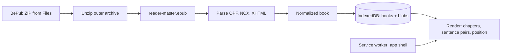
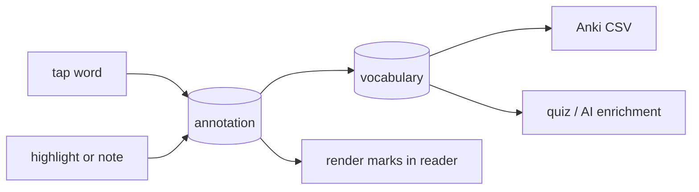

# DuoReader — design brief

**Status:** M3 verified on device: finished one whole book in airplane mode, after the persistence request, import error handling, source-only fallback, lazy images, and parser/position/storage tests. Reader font picker shipped in 0.4.0 from an editable catalog in `src/reader/fonts.json`. System theme shipped in 0.5.0 and is now the default; verified on device on 2026-11-14: flipping the system appearance repaints the app, and stored Light/Sepia/Dark choices ignore the flip. Version 0.5.0. Page mode postponed: scroll mode reads well. Next: the learning layer in §17, starting with the annotations core.
**Date:** 2026-11-14

## 1. Summary

DuoReader is a personal, offline-first reader for BePub bilingual exports. It imports the BePub ZIP, reads `reader-master.epub`, and displays the book as source/translation sentence pairs: source leading, translation smaller and dimmed underneath. It runs as an installable PWA on iPad and iPhone, stores books and reading positions on-device, and works in airplane mode after the first load.

Success is concrete: **finish one whole book on the iPad, offline, without losing the reading position.**

## 2. Goals and success criteria

- Import a BePub ZIP from the iOS Files picker; keep several books on a shelf.
- Read sentence-aligned pairs with original paragraph grouping and illustrations.
- Navigate by chapter, show progress, resume within one sentence after force-quit.
- Fully offline after installation: no server, account, or network dependency while reading.
- Comfortable at iPad width and at 390 px iPhone width.
- Adjust font size, line height, and light/sepia/dark theme.
- In three months: one finished book, read on the iPad in airplane mode, position never lost.

## 3. Non-goals for v1

- Page-flip mode (milestone 4; it is a second layout engine).
- Paragraph, two-column, or original-only reading modes.
- Translation generation or editing; input is already translated.
- Repairing or rewriting imported book content inside DuoReader; import warnings expose issues, but fixes belong upstream in BePub.
- Automatic or in-reader cross-edition annotation migration; deferred to a separate, rare-use tool.
- Dictionary lookup, TTS, highlights, notes, search, sync, accounts.
- Arbitrary EPUB import, DRM, Kindle formats.
- Native iOS/Android app or App Store distribution.

## 4. Users and scenarios

Single user, personal tool, no auth.

Typical session: open the installed app on iPad, tap a book, continue at the saved sentence, read for 20 minutes with Wi-Fi off.

Other scenarios: import a new ZIP from Files; switch books; rotate the device.

Failure cases: malformed ZIP, untranslated paragraph, iOS storage eviction, app relaunched offline.

## 5. Functional requirements

| Priority | Requirement |
|---|---|
| Must | Import BePub ZIP; locate and validate `reader-master.epub` |
| Must | Normalize title, author, languages, spine, chapter labels, pair blocks, images |
| Must | Library shelf: list, open, delete, show progress |
| Must | Sentence-pair rendering: source primary, translation secondary with left rule |
| Must | Preserve paragraph grouping and inline images; lazy-load images |
| Must | Chapter TOC with jump; number chapters where NCX has no title |
| Must | Open at the first spine item; show Next Chapter at the end, hidden on the last chapter |
| Must | Per-book position, progress percent, resume on reopen |
| Must | Font size, line height, theme; persisted settings |
| Must | Offline app shell, installable to Home Screen, safe-area-aware layout |
| Should | Import report: chapter/pair/image counts, untranslated blocks, warnings |
| Should | Render text-only blocks source-only instead of dropping them |
| Could | Global “hide translation” toggle; library backup/export; search |

## 6. Data and domain

Audited sample: **25 spine documents, 666 blocks, 1,877 sentence pairs, 43 images**. `reader-master.epub` is ≈1.0 MB; the outer ZIP is ≈4.0 MB. Pair IDs (`bid:start:end`) are globally unique and are the stable position keys. The CSV is redundant for this reader.

The NCX labels only front matter and the acknowledgments. The 17 novel chapters are unlabeled and are numbered “Chapter 1” through “Chapter 17”. A real content gap exists in `d_022`: the paragraph “Die Luft um mich herum bewegte sich –” has no translation pair. It renders source-only and is counted in the import report.

Normalized model, stored on import:

```
Book     { id, title, author, sourceLang, targetLang, chapters[], images{} }
Chapter  { index, label, blocks[] }
Block    = Image{ imageId } | Pairs{ pairs[] } | TextOnly{ text }
Pair     { id, bid, source, target }
Position { bookId, chapterIndex, pairId, progress, updatedAt }
```

Import is normalized once; reading never re-parses XHTML. Images are referenced by ID and loaded from storage.

IndexedDB layout: `books` holds small shelf metadata, `content` holds chapters, `images` holds image bytes plus media type keyed by `[bookId, imageId]` with a `by-book` index, `positions` holds one resume record per book, and `settings` holds the global reader typography/theme. Opening a book joins the book stores and rebuilds image Blobs from the bytes. This avoids Safari's unreliable Blob persistence.

**Edition identity:** an imported book is immutable and singular. `book.id` is the content hash of `reader-master.epub`; a different BePub edition is a different book. Annotations, notes, and vocabulary key on `bookId + pairId`, so there is no automatic cross-edition relinking or migration. Content quality fixes belong upstream in BePub, not in the reader.

Cross-edition migration is a separate, rare-use utility, not a reader feature. Annotation records retain `pairId`, `quote`, and surrounding context so a later export/relink tool can map old highlights and notes onto a new edition without the old book still being installed.

## 7. Typography and wrapping

Wrapping is a hard constraint, not a styling preference. Both languages are normal block text; no `nowrap`, and a pair boundary never forces one line.

- Default `line-height: 1.5` for source and translation; adjustable from 1.3 to 1.9.
- Source and target wrap independently. Translation keeps its smaller size (0.9em) and left rule, and may run to multiple lines.
- Preserve `lang="de"` / `lang="en"` on each span; use `hyphens: auto` where WebKit supports it.
- Backstop: `overflow-wrap: break-word`. The sample contains a 46-character unbroken token (`»Niiiiiiiiiiiiiiiiiiiiiiiiiiiiiiiieeeeeeeeeee!`) and a 227-character, 39-word sentence. Hyphenation cannot save the token; mid-word breaking must.
- Acceptance test: at 390 px width and maximum font size, the longest sentence and that 46-character token produce **zero horizontal overflow** at `line-height: 1.5`. Images may scale down; text never scrolls sideways.
- Defaults: serif body, system sans UI, 18 px base on phone, 1.5 line height, translation 0.9em.
- In future page mode, a pair may span pages; a pair taller than the viewport scrolls rather than being clipped.

## 8. Quality requirements

- Import of the 4 MB sample: ≤3 s on the target iPhone.
- Chapter open: ≤300 ms; the largest sample chapter is 166 pairs.
- Scrolling: no visible jank; render one chapter at a time.
- Cold start from Home Screen: ≤1 s.
- Reading makes zero network requests; app shell fully precached.
- No horizontal scrolling at 390 px; long German compounds must wrap.
- Resume accuracy: within one sentence.
- Storage: under 5 MB per book; request persistent storage. Home Screen web apps can request persistence, and WebKit grants it heuristically — not a guarantee ([WebKit storage policy](https://webkit.org/blog/14403/updates-to-storage-policy/)). Keep a re-import path if eviction happens.

## 9. Constraints and environment

- Static PWA hosted once over HTTPS; first load needs network, after that offline. No backend.
- Default stack: Vite + TypeScript, vanilla DOM, `fflate` for nested ZIP/EPUB, `idb` for IndexedDB, `vite-plugin-pwa` for precache. Vitest for parser tests.
- iOS 17+ assumed; both iPhone and iPad. Mac/Xcode available later, not now.
- Imported EPUBs are untrusted input: render text via `textContent`, never `innerHTML`; allow only local image blobs; no external resources; cap decompressed size and entry count.
- UI language: English by default; book languages come from metadata.

## 10. Approaches considered

| Approach | Trade-off | Verdict |
|---|---|---|
| **A. Normalize on import, custom renderer** | Parser work up front; full control of typography, progress, sanitization, and future page mode | **Chosen** |
| B. Render `reader-master` XHTML chapters in an iframe with injected CSS | Less parsing; EPUB CSS leaks, sentence-level progress and page mode are fragile | Rejected |
| C. Render `bilingual-sentence.epub` in an iframe | Least code; fixed styling, no per-pair state, still needs nested unzip | Rejected |
| D. Do nothing — keep using the BePub website | Zero build; no offline, no device persistence, no control | Rejected: offline is the stated requirement |

Delivery was settled as a static PWA over a self-contained HTML file (fragile on iOS, no persistent library) and a native shell (Xcode/signing cost too early). The PWA keeps the native path open: the same web code can later be wrapped with Capacitor.

## 11. Design sketch



Import pipeline: outer ZIP → `reader-master.epub` → OPF spine/manifest → per-document blocks → pairs and images.

Reader pipeline: load normalized chapter → render blocks → observe top visible pair → debounced position write.

## 12. Risks and unknowns

| Risk | Mitigation |
|---|---|
| iOS evicts PWA storage | Call `navigator.storage.persist()`; instruct Home Screen install; keep normalized data small; make re-import easy; test relaunch |
| Import parser misses malformed markup | Audit against the sample; source-only fallback for text without pairs; import report; cap ZIP size |
| EPUB CSS/scripts compromise rendering or security | Never apply book CSS; `textContent` only; local image blobs only; no network |
| Page mode is harder than expected | Deferred; keep block-level model so pagination can reuse it |
| iPhone layout cramped | Design at 390 px first; test long words, images, font-size changes |
| Scope creep into dictionary/TTS | Explicit non-goals; read-only v1 |
| PWA update breaks offline | Versioned precache; test installed relaunch after deploy |

Pre-mortem: the likely failure is motivation, not technology — the parser and layout feel fiddly, the reading loop never becomes pleasant, and the project stalls. The parser spike plus one real chapter on the phone is the cheapest way to falsify that early.

## 13. Phased plan

| Milestone | Work | Done signal |
|---|---|---|
| **M0 — Parser spike** | Parse the sample ZIP in the browser; emit normalized stats; render one chapter in a throwaway page | `d_022` displays pairs, images, and the source-only paragraph at phone width |
| **M1 — PWA skeleton** | Vite app, manifest, service worker, ZIP picker, library, normalized storage, open chapter | Installed app imports the ZIP and reads `d_006` in airplane mode after relaunch |
| **M2 — Reading loop** | All chapters, TOC, progress, resume, typography/themes, iPhone/iPad layout | Read a full chapter, force-quit, reopen at the same sentence; no horizontal scroll |
| **M3 — Hardening** | Persistence request, import errors, untranslated fallback, lazy images, parser/position tests | Finish one whole book offline |
| **M4 — Page mode (postponed)** | Page index mapping, font/rotation reflow, pair-height handling | Scroll mode reads well enough; revisit only if page turning is missed |
| **M5 — Native shell** | Capacitor wrapper only if PWA limits bite | App runs standalone without browser chrome |

M0–M3 are complete. M3 was verified on device on 2026-11-14 by finishing one whole book in airplane mode.

## 14. Open questions

- Hosting: GitHub Pages or Cloudflare Pages? Default GitHub Pages if this becomes a repo.
- UI language: English, Vietnamese, or German? Default English.
- Minimum iOS version: assume 17+.
- Untranslated blocks: source-only silently, or visibly marked? Default source-only, counted in the import report.
- Library shelf: simple list, or cover thumbnails? Default list.
- Import diagnostics: on-screen warnings only, or a downloadable report for BePub authors? Default on-screen.

## 15. Post-M2 backlog

Checked on 2026-11-14: resume, font size, line height, theme, and airplane mode pass on the installed app; one whole book read offline end to end.

- **Reader font picker** — done in 0.4.0, focus fix in 0.4.1. The picker offers Athelas, Avenir Next, Charter, Georgia, Iowan, New York, Palatino, San Francisco, Seravek, and Times New Roman; no bold toggle. Choices live in `src/reader/fonts.json` as `{ id, label, stack }` records with a `default` id, so the list can change without touching reader code. Stacks are iOS-first with desktop fallbacks, and an unknown or missing stored id normalizes to the default. Default remains New York (serif) to preserve the previous look; sans is available through the same picker rather than as a separate mode. The dialog opens with the heading focused, because `showModal()` would otherwise focus the font `<select>` and iOS pops its native picker open on focus.
- **System theme** — done in 0.5.0. `ReaderTheme` gained `system`, resolved to the light or dark palette from a `matchMedia('(prefers-color-scheme: dark)')` query; a `change` listener reapplies only while `system` is stored. `System` is the default, so a fresh install matches the device; stored Light/Sepia/Dark choices are untouched. Because `data-theme` only ever holds a resolved palette, the existing CSS theme blocks are unchanged. The resolved palette is mirrored to `localStorage['duoreader.theme']` and an inline shim in `index.html` reads it before the bundle runs, so cold start paints the right palette before the async IndexedDB read; the shim duplicates the three `THEME_COLORS` values with a comment pointing at `src/reader/settings.ts`. Device check passed on 2026-11-14: the open installed app follows a system appearance flip, and explicit Light/Sepia/Dark choices are unaffected.

## 16. Versioning and build identity

`package.json` `version` is the single human-facing app version. Bump it before a release commit: minor for user-visible behavior, patch for fixes. Do not hand-edit version strings elsewhere.

The build identity is derived from git at build time:

```
version  0.2.0          package.json
build    12             git rev-list --count HEAD
commit   a1b2c3d        short HEAD
dirty    false          working tree changed at build time (shown as +)
```

`vite.config.ts` injects this object into the bundle and emits `dist/build-manifest.json`. The Library screen displays `v0.2.0 · build 12 · a1b2c3d`; the `+` suffix warns that the loaded build came from an uncommitted tree. The displayed tag is the identity to quote in an issue report.

CI checks out full history so the build number matches the deployed commit. A release is built from a clean `main`; local dirty builds are useful for development but are not release identities.

## 17. Learning layer (proposed, not started)

Goal: use the bilingual corpus the importer already produces as a learning system. Reading stays the primary mode; every learning feature must be reachable without leaving the page, and all learning data stays on the device by default.

### 17.1 Why this shape

- The pair already gives sentence-level meaning. The missing pieces are word-level meaning, pronunciation, and recall.
- A captured word only pays off when it is reviewed elsewhere, so the Anki export is part of the core loop, not an add-on.
- Highlights, notes, dictionary lookups, and future AI output all attach to the same coordinates as a vocabulary entry, so one store and one interaction keep the feature set coherent instead of five overlapping ones.



### 17.2 Coordinates and data model

Rendering keeps one text node per side (`pair.source`, `pair.target`); an annotation stores character offsets into that string plus the captured text, not a token index. Offsets survive tokenizer changes, and the stored text lets the reader detect drift after a re-import and skip a mark instead of mis-highlighting.

```ts
interface Annotation {
  id: string;                 // crypto.randomUUID()
  bookId: string;             // book-<source hash>; stable for the same ZIP
  chapterIndex: number;
  pairId: string;             // publisher pair id
  side: 'source' | 'target';
  start: number;              // character offsets into the pair string
  end: number;
  text: string;               // exact slice, for validation
  kind: 'word' | 'phrase' | 'sentence' | 'note';
  color: 'yellow' | 'green' | 'blue' | 'pink';
  note?: string;
  createdAt: number;
  updatedAt: number;
}

interface VocabularyEntry {
  id: string;
  bookId: string;
  pairId: string;
  side: 'source' | 'target';
  start: number;
  end: number;
  term: string;               // normalized headword used for dedupe
  surface: string;            // as it appeared
  context: string;            // the full source sentence
  translation: string;        // the pair's target sentence
  entry: string;              // dictionary gloss, when one exists
  status: 'new' | 'learning' | 'exported' | 'known';
  tags: string[];             // book title, chapter label
  createdAt: number;
  exportedAt?: number;
}
```

Storage moves to DB v3: new `annotations` store (key `id`, indexes `by-book`, `by-book-pair`) and `vocabulary` store (key `id`, indexes `by-book`, `by-term`, `by-status`). Existing stores are untouched, so the v1→v2 upgrade test gains a v2→v3 sibling. Deleting a book deletes its annotations but keeps vocabulary entries, which carry their own book title, so exports never lose provenance.

### 17.3 Interaction

- **Word:** a tap on a rendered sentence maps the point to a character offset (`caretRangeFromPoint`, `caretPositionFromPoint` fallback), expands to word boundaries with `Intl.Segmenter` (`granularity: 'word'`), and opens a bottom sheet: word, source and target sentence, and actions — Speak, Define, Highlight, Save, Note.
- No token spans in the DOM: they would break line breaking for long German compounds and native text selection for a marginal win.
- **Sentence:** the same sheet on pair level, with sentence highlight and the pair's own translation.
- **Notes** are sentence-level annotations rendered as a margin marker; the sheet edits them.
- Marks are applied by splitting the single text node at the stored offsets and wrapping the slice in `<mark>`, so no `innerHTML` ever touches book text.

### 17.4 Delivery order

Ordered by impact per unit of work, not by the feature list.

| Milestone | Work | Why now | Done signal |
|---|---|---|---|
| **L0 — Annotations core** | DB v3, annotation store, bottom sheet, sentence highlight, notes | Proves the coordinates, sheet, and mark rendering with the simplest input | Highlight a pair, add a note, relaunch, both return |
| **L1 — Word capture** | Point-to-offset mapping, `Intl.Segmenter` word expansion, word highlight, Save to vocabulary | Turns reading into collecting | Tap a German word, see both sentences, save it |
| **L2 — Review loop** | Vocabulary screen (search, filter by status/book), CSV export with an Anki field preset, dedupe by term | Captured words become cards | Export a book's words, import into Anki, fields intact, umlauts intact |
| **L3 — TTS** | `speechSynthesis` for word and sentence, rate and voice choice, stop on navigation | Pronunciation, no data cost | Read a paragraph aloud in German, word taps speak the word |
| **L4 — Dictionary** | Optional installable de→en corpus in IndexedDB, inflection and compound heuristics, offline after install; external link fallback before that | Word-level gloss the pair cannot give | Lookup works in airplane mode after install |
| **L5 — AI enrichment** | Explain word, phrase, idiom, usage; generated quiz items from vocabulary; cached results | Adds depth once the loop exists | Every AI result is cached and re-opens offline |

L0–L2 are the core: capture with context, export, review. L3–L5 enrich that loop instead of standing alone.

### 17.5 Anki export

- CSV/TSV download, UTF-8 with BOM, comma or tab as chosen at export, quoted as needed.
- Fixed field order: `Word, Context, Translation, Entry, Book, Chapter, Created`. Context renders the captured word in `<b>` inside the sentence so Anki's card template can show it; Anki imports HTML fields fine.
- Export scope: current book, all books, or only `new`; exported entries are marked `exported` and can be re-exported.
- Rejected: generating `.apkg` in the browser. It needs a SQLite writer (roughly 1 MB of wasm plus a schema to maintain) for no user-visible gain over CSV import, and it cannot target AnkiWeb.

### 17.6 Dictionary options

| Option | Cost | Verdict |
|---|---|---|
| External link (dict.cc, Leo, Wiktionary) opened from the sheet | Zero data, needs network, leaves the app | Fallback in L1; the sheet always has it |
| Bundled corpus precached in the app shell | App shell grows by the whole corpus for every user | Rejected: breaks the "cold start ≤1 s" budget |
| Installable corpus in IndexedDB, downloaded on request, offline afterwards | One explicit network action, 1–3 MB per install | Chosen for L4, subject to a licence that allows redistribution |
| AI lookup | Network and cost per lookup | Part of L5, cached |

Inflection and compound handling is heuristic and must be labelled: exact match, then lowercase, then German compound split (longest dictionary suffix match), then a short inflection strip list. Show "possibly" when a heuristic produced the hit; never invent a gloss.

### 17.7 TTS

`speechSynthesis` with `lang` set from book metadata, default sentence-level playback and a word-level tap. Rate persists in settings (new normalized field, default 1.0). iOS only synthesizes voices that are installed on the device; the sheet states that when no voice matches the language. No server TTS.

### 17.8 AI layer (L5)

- Static PWA cannot hide a key, so AI runs either with a user-supplied provider key stored locally or not at all. A proxy is only justified if the user later wants shared use.
- Gated by an explicit toggle with a one-screen privacy note; reading and every other feature stay offline when it is off.
- Requests are per selected word or phrase with the two sentences as context; responses are cached by hash of `model + prompt version + text`, so repeat views and offline re-opens cost nothing.
- Quizzes are generated from `vocabulary` entries, not from random book text, so they reinforce what the user chose to learn.

### 17.9 Risks

| Risk | Mitigation |
|---|---|
| Point-to-offset mapping misreads taps on iOS | Test on device first in L1; keep sentence-level actions as the fallback when mapping fails |
| Marks fight hyphenation or line breaking | `mark` inherits text; verify long compounds at 390 px |
| Re-import changes the book id or pair ids | Store text with every annotation; skip and count unmatched marks, never guess |
| Annotation growth against the 5 MB per-book budget | Offsets and short notes are a few hundred bytes each; measure at L0, cap note length |
| Dictionary licence | Pick the corpus before L4 starts, record the licence and attribution in the app |
| TTS voice availability | Detect and explain; never fail silently |
| AI privacy and cost | Off by default, local key, cached, visible per-request size |

### 17.10 Decisions needed

1. **Dictionary timing**: ship the external-link fallback in L1 and defer the installable corpus to L4 (recommended), or block L1 until an offline corpus is chosen.
2. **Corpus**: which de→en dataset is acceptable — Wiktionary-derived with CC BY-SA attribution, a permissively licensed glossary, or the user's own export.
3. **Anki template**: fixed field order as above, or match an existing deck the user already reviews.
4. **AI access**: user-supplied key per provider (recommended) versus a proxy you host.
