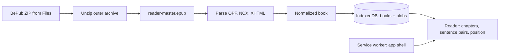

# DuoReader — design brief

**Status:** M3 verified on device: finished one whole book in airplane mode, after the persistence request, import error handling, source-only fallback, lazy images, and parser/position/storage tests. Reader font picker shipped in 0.4.0 from an editable catalog in `src/reader/fonts.json`. System theme shipped in 0.5.0 and is now the default; verified on device on 2026-11-14: flipping the system appearance repaints the app, and stored Light/Sepia/Dark choices ignore the flip. Version 0.5.0. Page mode postponed: scroll mode reads well. Next: the learning layer, planned in `LEARNING.md` (see §17), starting with the annotations core. Display modes (paragraph, hide-translation, language order) are planned in §18.
**Date:** 2026-11-14

Repo map, commands, invariants, and agent instructions: **`AGENTS.md`**. BePub archive format: **`DATA-FORMAT.md`**. Learning layer: **`LEARNING.md`**.

## 1. Summary

DuoReader is a personal, offline-first reader for BePub bilingual exports. It imports the BePub ZIP, reads `reader-master.epub`, and displays the book as source/translation sentence pairs: source leading, translation smaller and dimmed underneath. It runs as an installable PWA on iPad and iPhone, stores books and reading positions on-device, and works in airplane mode after the first load.

Success is concrete: **finish one whole book on the iPad, offline, without losing the reading position.**

## 2. Goals and success criteria

- Import a BePub ZIP from the iOS Files picker; keep several books on a shelf.
- Read sentence-aligned pairs with original paragraph grouping and illustrations.
- Navigate by chapter, show progress, resume within one sentence after force-quit.
- Fully offline after installation: no server, account, or network dependency while reading.
- Comfortable at iPad width and at 390 px iPhone width.
- Adjust font size, line height, and light/sepia/dark theme.
- In three months: one finished book, read on the iPad in airplane mode, position never lost.

## 3. Non-goals for v1

- Page-flip mode (milestone 4; it is a second layout engine).
- Paragraph, two-column, or original-only reading modes in v1; paragraph, hide-translation, and language-order modes are planned after it (§18).
- Translation generation or editing; input is already translated.
- Repairing or rewriting imported book content inside DuoReader; import warnings expose issues, but fixes belong upstream in BePub.
- Automatic or in-reader cross-edition annotation migration; deferred to a separate, rare-use tool.
- Search, sync, accounts, and in-app spaced repetition.
- Dictionary lookup, TTS, highlights, notes, and vocabulary export: planned as a separate learning layer in `LEARNING.md`, not part of the reading loop.
- Arbitrary EPUB import, DRM, Kindle formats.
- Native iOS/Android app or App Store distribution.

## 4. Users and scenarios

Single user, personal tool, no auth.

Typical session: open the installed app on iPad, tap a book, continue at the saved sentence, read for 20 minutes with Wi-Fi off.

Other scenarios: import a new ZIP from Files; switch books; rotate the device.

Failure cases: malformed ZIP, untranslated paragraph, iOS storage eviction, app relaunched offline.

## 5. Functional requirements

| Priority | Requirement |
|---|---|
| Must | Import BePub ZIP; locate and validate `reader-master.epub` |
| Must | Normalize title, author, languages, spine, chapter labels, pair blocks, images |
| Must | Library shelf: list, open, delete, show progress |
| Must | Sentence-pair rendering: source primary, translation secondary with left rule |
| Must | Preserve paragraph grouping and inline images; lazy-load images |
| Must | Chapter TOC with jump; number chapters where NCX has no title |
| Must | Open at the first spine item; show Next Chapter at the end, hidden on the last chapter |
| Must | Per-book position, progress percent, resume on reopen |
| Must | Font size, line height, theme; persisted settings |
| Must | Offline app shell, installable to Home Screen, safe-area-aware layout |
| Should | Import report: chapter/pair/image counts, untranslated blocks, warnings |
| Should | Render text-only blocks source-only instead of dropping them |
| Could | Hide-translation toggle, paragraph/side-by-side mode, language-order swap (planned, §18); library backup/export; search |

## 6. Data and domain

Audited sample: **25 spine documents, 666 blocks, 1,877 sentence pairs, 43 images**. `reader-master.epub` is ≈1.0 MB; the outer ZIP is ≈4.0 MB. Pair IDs (`bid:start:end`) are globally unique and are the stable position keys. The CSV is redundant for this reader.

The NCX labels only front matter and the acknowledgments. The 17 novel chapters are unlabeled and are numbered “Chapter 1” through “Chapter 17”. A real content gap exists in `d_022`: the paragraph “Die Luft um mich herum bewegte sich –” has no translation pair. It renders source-only and is counted in the import report.

Normalized model, stored on import:

```
Book     { id, title, author, sourceLang, targetLang, chapters[], images{} }
Chapter  { index, label, blocks[] }
Block    = Image{ imageId } | Pairs{ pairs[] } | TextOnly{ text }
Pair     { id, bid, source, target }
Position { bookId, chapterIndex, pairId, progress, updatedAt }
```

Display-mode additions to this model — pair offsets, block ids, inline runs,
derived paragraph text — are specified in §18.

Import is normalized once; reading never re-parses XHTML. Images are referenced by ID and loaded from storage.

IndexedDB layout: `books` holds small shelf metadata, `content` holds chapters, `images` holds image bytes plus media type keyed by `[bookId, imageId]` with a `by-book` index, `positions` holds one resume record per book, and `settings` holds the global reader typography/theme. Opening a book joins the book stores and rebuilds image Blobs from the bytes. This avoids Safari's unreliable Blob persistence.

**Edition identity:** an imported book is immutable and singular. `book.id` is the content hash of `reader-master.epub`; a different BePub edition is a different book. Annotations, notes, and vocabulary key on `bookId + pairId`, so there is no automatic cross-edition relinking or migration. Content quality fixes belong upstream in BePub, not in the reader.

Cross-edition migration is a separate, rare-use utility, not a reader feature. Annotation records retain `pairId`, `quote`, and surrounding context so a later export/relink tool can map old highlights and notes onto a new edition without the old book still being installed.

## 7. Typography and wrapping

Wrapping is a hard constraint, not a styling preference. Both languages are normal block text; no `nowrap`, and a pair boundary never forces one line.

- Default `line-height: 1.5` for source and translation; adjustable from 1.3 to 1.9.
- Source and target wrap independently. Translation keeps its smaller size (0.9em) and left rule, and may run to multiple lines.
- Preserve `lang="de"` / `lang="en"` on each span; use `hyphens: auto` where WebKit supports it.
- Backstop: `overflow-wrap: break-word`. The sample contains a 46-character unbroken token (`»Niiiiiiiiiiiiiiiiiiiiiiiiiiiiiiiieeeeeeeeeee!`) and a 227-character, 39-word sentence. Hyphenation cannot save the token; mid-word breaking must.
- Acceptance test: at 390 px width and maximum font size, the longest sentence and that 46-character token produce **zero horizontal overflow** at `line-height: 1.5`. Images may scale down; text never scrolls sideways.
- Defaults: serif body, system sans UI, 18 px base on phone, 1.5 line height, translation 0.9em.
- In future page mode, a pair may span pages; a pair taller than the viewport scrolls rather than being clipped.

## 8. Quality requirements

- Import of the 4 MB sample: ≤3 s on the target iPhone.
- Chapter open: ≤300 ms; the largest sample chapter is 166 pairs.
- Scrolling: no visible jank; render one chapter at a time.
- Cold start from Home Screen: ≤1 s.
- Reading makes zero automatic network requests; the app shell is fully precached. The only egress is an explicit, user-initiated action: the external Define lookup when online, and later opt-in AI features (`LEARNING.md` D12).
- No horizontal scrolling at 390 px; long German compounds must wrap.
- Resume accuracy: within one sentence.
- Storage: under 5 MB per book; request persistent storage. Home Screen web apps can request persistence, and WebKit grants it heuristically — not a guarantee ([WebKit storage policy](https://webkit.org/blog/14403/updates-to-storage-policy/)). Keep a re-import path if eviction happens.

## 9. Constraints and environment

- Static PWA hosted once over HTTPS; first load needs network, after that offline. No backend.
- Default stack: Vite + TypeScript, vanilla DOM, `fflate` for nested ZIP/EPUB, `idb` for IndexedDB, `vite-plugin-pwa` for precache. Vitest for parser tests.
- iOS 17+ assumed; both iPhone and iPad. Mac/Xcode available later, not now.
- Imported EPUBs are untrusted input: render text via `textContent`, never `innerHTML`; allow only local image blobs; no external resources; cap decompressed size and entry count.
- UI language: English by default; book languages come from metadata.

## 10. Approaches considered

| Approach | Trade-off | Verdict |
|---|---|---|
| **A. Normalize on import, custom renderer** | Parser work up front; full control of typography, progress, sanitization, and future page mode | **Chosen** |
| B. Render `reader-master` XHTML chapters in an iframe with injected CSS | Less parsing; EPUB CSS leaks, sentence-level progress and page mode are fragile | Rejected |
| C. Render `bilingual-sentence.epub` in an iframe | Least code; fixed styling, no per-pair state, still needs nested unzip | Rejected |
| D. Do nothing — keep using the BePub website | Zero build; no offline, no device persistence, no control | Rejected: offline is the stated requirement |

Delivery was settled as a static PWA over a self-contained HTML file (fragile on iOS, no persistent library) and a native shell (Xcode/signing cost too early). The PWA keeps the native path open: the same web code can later be wrapped with Capacitor.

## 11. Design sketch



Import pipeline: outer ZIP → `reader-master.epub` → OPF spine/manifest → per-document blocks → pairs and images.

Reader pipeline: load normalized chapter → render blocks → observe top visible pair → debounced position write.

## 12. Risks and unknowns

| Risk | Mitigation |
|---|---|
| iOS evicts PWA storage | Call `navigator.storage.persist()`; instruct Home Screen install; keep normalized data small; make re-import easy; test relaunch |
| Import parser misses malformed markup | Audit against the sample; source-only fallback for text without pairs; import report; cap ZIP size |
| EPUB CSS/scripts compromise rendering or security | Never apply book CSS; `textContent` only; local image blobs only; no network |
| Page mode is harder than expected | Deferred; keep block-level model so pagination can reuse it |
| iPhone layout cramped | Design at 390 px first; test long words, images, font-size changes |
| Learning features crowd out reading | Ordered, separately documented in `LEARNING.md`; core capture/export stays offline; no in-app SRS in v1 |
| PWA update breaks offline | Versioned precache; test installed relaunch after deploy |

Pre-mortem: the likely failure is motivation, not technology — the parser and layout feel fiddly, the reading loop never becomes pleasant, and the project stalls. The parser spike plus one real chapter on the phone is the cheapest way to falsify that early.

## 13. Phased plan

| Milestone | Work | Done signal |
|---|---|---|
| **M0 — Parser spike** | Parse the sample ZIP in the browser; emit normalized stats; render one chapter in a throwaway page | `d_022` displays pairs, images, and the source-only paragraph at phone width |
| **M1 — PWA skeleton** | Vite app, manifest, service worker, ZIP picker, library, normalized storage, open chapter | Installed app imports the ZIP and reads `d_006` in airplane mode after relaunch |
| **M2 — Reading loop** | All chapters, TOC, progress, resume, typography/themes, iPhone/iPad layout | Read a full chapter, force-quit, reopen at the same sentence; no horizontal scroll |
| **M3 — Hardening** | Persistence request, import errors, untranslated fallback, lazy images, parser/position tests | Finish one whole book offline |
| **M4 — Page mode (postponed)** | Page index mapping, font/rotation reflow, pair-height handling | Scroll mode reads well enough; revisit only if page turning is missed |
| **M5 — Native shell** | Capacitor wrapper only if PWA limits bite | App runs standalone without browser chrome |

M0–M3 are complete. M3 was verified on device on 2026-11-14 by finishing one whole book in airplane mode. M4 is postponed; the learning layer and its L0–L5 milestones live in `LEARNING.md`.

## 14. Open questions

- Hosting: GitHub Pages or Cloudflare Pages? Default GitHub Pages if this becomes a repo.
- UI language: English, Vietnamese, or German? Default English.
- Minimum iOS version: assume 17+.
- Untranslated blocks: source-only silently, or visibly marked? Default source-only, counted in the import report.
- Library shelf: simple list, or cover thumbnails? Default list.
- Import diagnostics: on-screen warnings only, or a downloadable report for BePub authors? Default on-screen.

## 15. Post-M2 backlog

Checked on 2026-11-14: resume, font size, line height, theme, and airplane mode pass on the installed app; one whole book read offline end to end.

- **Reader font picker** — done in 0.4.0, focus fix in 0.4.1. The picker offers Athelas, Avenir Next, Charter, Georgia, Iowan, New York, Palatino, San Francisco, Seravek, and Times New Roman; no bold toggle. Choices live in `src/reader/fonts.json` as `{ id, label, stack }` records with a `default` id, so the list can change without touching reader code. Stacks are iOS-first with desktop fallbacks, and an unknown or missing stored id normalizes to the default. Default remains New York (serif) to preserve the previous look; sans is available through the same picker rather than as a separate mode. The dialog opens with the heading focused, because `showModal()` would otherwise focus the font `<select>` and iOS pops its native picker open on focus.
- **System theme** — done in 0.5.0. `ReaderTheme` gained `system`, resolved to the light or dark palette from a `matchMedia('(prefers-color-scheme: dark)')` query; a `change` listener reapplies only while `system` is stored. `System` is the default, so a fresh install matches the device; stored Light/Sepia/Dark choices are untouched. Because `data-theme` only ever holds a resolved palette, the existing CSS theme blocks are unchanged. The resolved palette is mirrored to `localStorage['duoreader.theme']` and an inline shim in `index.html` reads it before the bundle runs, so cold start paints the right palette before the async IndexedDB read; the shim duplicates the three `THEME_COLORS` values with a comment pointing at `src/reader/settings.ts`. Device check passed on 2026-11-14: the open installed app follows a system appearance flip, and explicit Light/Sepia/Dark choices are unaffected.

## 16. Versioning and build identity

`package.json` `version` is the single human-facing app version. Bump it before a release commit: minor for user-visible behavior, patch for fixes. Do not hand-edit version strings elsewhere.

The build identity is derived from git at build time:

```
version  0.2.0          package.json
build    12             git rev-list --count HEAD
commit   a1b2c3d        short HEAD
dirty    false          working tree changed at build time (shown as +)
```

`vite.config.ts` injects this object into the bundle and emits `dist/build-manifest.json`. The Library screen displays `v0.2.0 · build 12 · a1b2c3d`; the `+` suffix warns that the loaded build came from an uncommitted tree. The displayed tag is the identity to quote in an issue report.

## 17. Learning layer

Separate document: **`LEARNING.md`**. It owns the learning loop — annotations, vocabulary, dictionary lookup, TTS, Anki export, and the later AI features — including the option/pro-con dossiers behind each open decision.

The only commitments here: reading stays the primary mode, the core capture/review loop works offline, and any network feature is an explicit user action. L0 (annotations core) is unblocked and starts in `LEARNING.md` §6.

## 18. Planned display modes

Three reading options share one data contract. The archive already carries
everything; `DATA-FORMAT.md` §4–§6 define the markup and derivation rules.

| Mode | Behaviour | Learner benefit |
|---|---|---|
| Sentence (today) | source sentence, then target sentence, per pair | fine-grained comparison |
| Paragraph | whole source paragraph, then the same paragraph in the target language; two columns when the reading column is wide enough | cohesion, natural reading, less fragmentation |
| Translation hidden | target omitted, source only | advanced readers stop leaning on the crutch |
| Language order | target first — per pair in sentence mode, per paragraph in paragraph mode | L2-first immersion |

No BePub change is required. Paragraph source is reconstructed exactly from
`data-start`/`data-end` gaps (666/666 sample blocks); paragraph target is the
single-space join of pair targets and equals `bilingual-paragraph`'s output.
The rendered variants remain unused as data sources.

Model (`src/reader/types.ts`, `src/reader/parse.ts`):

```
Pair  { id, bid, start, end, source, target, sourceRuns?, targetRuns? }
Block = Pairs{ bid, pairs[] } | Image | TextOnly
```

- Keep `start`/`end` and the block `bid`; both are currently discarded.
- **Inline formatting:** retain `i`/`em`, `b`/`strong`, and `br` as runs
  (`InlineRun { text, style?: 'em' | 'strong', break?: true }`); every other
  element is flattened into text. Literature uses italics for interior
  monologue, titles, and emphasis, so plain text loses meaning. Build DOM
  with `textContent` nodes behind a fixed whitelist (`i|em → em`,
  `b|strong → strong`, `br → br`); never `innerHTML`, no attributes, no
  links.
- Runs are optional on `Pair`: books imported before this change keep
  rendering as plain text and gain formatting only after re-import.
- Text outside pairs inside a paragraph container is dropped today; the run
  model should capture it in reading order instead.

Paragraph derivation: a pure `blockParagraph(block)` in a new
`src/reader/paragraph.ts`, called at render time (no second copy stored).
Source = pair runs concatenated with `start − previousEnd` separator spaces
(never a plain `join(' ')`); target = runs joined with one space.

Settings (`normalizeSettings`): `displayMode: 'sentence' | 'paragraph'`,
`translation: 'show' | 'hide'`, `languageFirst: 'source' | 'target'`. Defaults
keep today's view; unknown values fall back. No storage migration: settings
are normalized on load and the fields are additive.

Renderer (`src/main.ts`): paragraph mode emits one element per pairs block
with `.src` and `.tgt`; `data-pair-id` is the block's first pair id so
`scrollToPair`, `topPairId`, and `progressAt` keep working. Resume across
modes resolves a saved pair id to its containing block. Side-by-side is CSS,
not a setting: two columns via a container query on the reading column, one
column on phone widths; `languageFirst` flips DOM order, `translation` hides
`.tgt`.

Tests: offsets and runs in the parser; `blockParagraph` for gap 0 vs 1,
untranslated blocks, and runs; settings normalization; Playwright for mode
toggle, hidden translation, swapped order, and the two-column layout at
tablet width.

Upstream asks (optional): block `data-bid` on the container; a guarantee
that inter-pair gaps are whitespace; a paragraph translation field only if
paragraph MT ever differs from the sentence join.

Risks: non-whitespace gaps break reconstruction; target joins assume MT
spans never need to abut after a space; old books lack runs until re-imported.
Do not implement the manifest's advertised `columns` mode — no columns
artifact exists.
