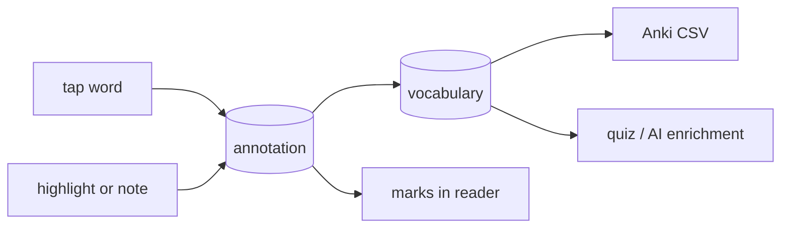

# DuoReader — learning layer

Companion to `DESIGN.md`. `DESIGN.md` stays the reader brief; this file owns the
learning features: capture, lookup, pronunciation, review, and later AI support.
It is a decision document first and an implementation plan second.

**Status:** proposed, nothing implemented. Last revised 2026-11-14.
**Owner:** the single user of this app; there is no server and no multi-user data.

## 1. Purpose

Turn the bilingual pairs the importer already produces into a learning loop
without turning the reader into a course platform:

1. encounter a word in a sentence,
2. get its meaning and pronunciation in place,
3. keep it with the sentence and translation that gave it meaning,
4. review it outside the app (Anki),
5. optionally deepen it (idioms, usage, quizzes) with AI.

Reading remains the primary activity. Every learning action must be reachable
from the sentence it belongs to, in at most two taps.

## 2. Constraints that shape every decision

| Constraint | Source | Consequence |
|---|---|---|
| Static PWA, no backend | `DESIGN.md` §9 | No server-side dictionary, no hidden API keys, no sync |
| Reading makes zero network requests | §8 | Any network feature is explicit, user-initiated, and disabled by default |
| Cold start ≤ 1 s, shell precached | §8 | No large corpus in the app shell |
| Under 5 MB per book | §8 | Annotations must stay small; images dominate today |
| iOS 17 Safari / Home Screen app | §9 | `Intl.Segmenter`, `caretRangeFromPoint`, `speechSynthesis` available; native selection is quirky |
| Text rendered with `textContent` only | §9 | No `innerHTML` for book text; marks must be built from text nodes |
| Book editions are immutable | §6 | `book.id` is a hash of the source; pair ids come from the publisher |

## 3. The loop



Layers, deliberately separable:

- **Core (offline):** annotations, vocabulary, marks, export. Works with no network and no AI.
- **Enrichment (optional):** TTS (offline), installed dictionary (offline after install), AI (network, opt-in).
- Every enrichment writes back into the core records, so the core never depends on which enrichments are enabled.

## 4. Coordinates and data model

Rendering keeps one text node per side (`pair.source`, `pair.target`). An
annotation stores character offsets into that string, plus the exact captured
text. Offsets survive tokenizer changes; the stored text lets the reader detect
drift after a re-import and skip a mark rather than mis-highlight.

```ts
interface Annotation {
  id: string;                 // crypto.randomUUID()
  bookId: string;             // book-<source hash>; stable for the same ZIP
  chapterIndex: number;
  pairId: string;             // publisher pair id
  side: 'source' | 'target';
  start: number;              // character offsets into the pair string
  end: number;
  text: string;               // exact slice, for validation
  kind: 'word' | 'phrase' | 'sentence' | 'note';
  color: 'yellow' | 'green' | 'blue' | 'pink';
  note?: string;
  createdAt: number;
  updatedAt: number;
}

interface VocabularyEntry {
  id: string;
  bookId: string;
  bookTitle: string;          // survives book deletion
  chapterLabel: string;
  pairId: string;
  side: 'source' | 'target';
  start: number;
  end: number;
  term: string;               // normalized headword for dedupe
  surface: string;            // as it appeared
  context: string;            // full source sentence
  translation: string;        // the pair's target sentence
  entry: string;              // dictionary gloss, when available
  status: 'new' | 'learning' | 'exported' | 'known';
  tags: string[];
  createdAt: number;
  exportedAt?: number;
}
```

Storage: IndexedDB v3 with `annotations` (key `id`, indexes `by-book`,
`by-book-pair`) and `vocabulary` (key `id`, indexes `by-book`, `by-term`,
`by-status`). Existing stores are untouched; the v1→v2 upgrade test gains a
v2→v3 sibling. Deleting a book deletes its annotations and keeps vocabulary,
which carries its own title and chapter label.

## 5. Interaction

- **Word tap:** map the point to a character offset (`caretRangeFromPoint`,
  `caretPositionFromPoint` fallback), expand with `Intl.Segmenter`
  (`granularity: 'word'`) to word boundaries, open a bottom sheet with the
  word, both sentences, and actions: Speak, Define, Highlight, Save, Note.
- **Sentence:** the same sheet at pair level, with sentence highlight and the
  pair's own translation.
- **Notes:** sentence-level annotation rendered as a margin marker; edited in
  the sheet.
- No token spans in the DOM: they would break line breaking for long German
  compounds and native selection, for a marginal gain.
- Marks split the single text node at the stored offsets and wrap the slice in
  `<mark>`; no `innerHTML` with book text.

## 6. Delivery order

Ordered by impact per unit of work, not by feature list.

| Milestone | Work | Done signal |
|---|---|---|
| **L0 — Annotations core** | DB v3, annotation store, bottom sheet, sentence highlight, notes | Highlight a pair, add a note, relaunch, both return |
| **L1 — Word capture** | Point-to-offset mapping, word expansion, word highlight, save to vocabulary | Tap a German word, see both sentences, save it |
| **L2 — Review loop** | Vocabulary screen (search, filter by status/book), dedupe, CSV export with an Anki preset | Export a book's words, import into Anki, fields and umlauts intact |
| **L3 — TTS** | `speechSynthesis` for word and sentence, rate and voice choice, stop on navigation | Read a paragraph aloud; word taps speak the word |
| **L4 — Dictionary** | Installable de→en corpus in IndexedDB, resolution heuristics, offline after install | Lookup works in airplane mode after install |
| **L5 — AI enrichment** | Explain word, phrase, idiom, usage; quiz items from vocabulary; cached results | Every AI result re-opens offline |

L0–L2 are the core loop. L3–L5 enrich it and can be skipped without breaking it.

## 7. Decision dossiers

Each dossier states the question, the realistic options with pros and cons, a
recommendation, and what it unblocks. Recommendations are defaults, not
commitments; L0 depends on none of them.

### D1. Where does a word gloss come from?

| Option | Pros | Cons |
|---|---|---|
| **A. External link** (dict.cc, Leo, Wiktionary) opened from the sheet | No data, no licence, works today, authoritative | Needs network, leaves the app, no offline reading, no integration into vocabulary |
| **B. Corpus precached in the app shell** | Offline from first launch, one code path | Adds megabytes to every install and to the service-worker precache; breaks the 1 s cold start; every user pays for a feature some ignore |
| **C. Corpus installed into IndexedDB on request** | Offline after one explicit download; app shell stays small; user chooses the languages | One network action, download UI, storage accounting, corpus lifecycle/versioning |
| **D. AI lookup on demand** | Handles idioms and context no glossary has | Network, cost, latency, privacy; needs the AI decision (D9) first |
| **E. Native shell dictionary** | Uses the iOS Look Up sheet | Contradicts the PWA-only plan (§10); would force M5 |
| **F. No dictionary; rely on the pair translation** | Zero work; the sentence translation is often enough | Blocks word-level precision, which is the point of vocabulary cards |

**Recommendation:** A in L1 (the sheet always offers it), C in L4, D only as part
of L5. Reject B and E.

### D2. Which corpus, and under what licence?

| Option | Pros | Cons |
|---|---|---|
| **Wiktionary-derived de→en extract** | Broad coverage, idioms and inflections, community-maintained | CC BY-SA: attribution and share-alike obligations; extraction and cleanup work; noisy entries |
| **FreeDict / other free dictionary projects** | Purpose-built bilingual data, clean entry structure | Licence varies per dictionary (some GPL); coverage and update cadence vary; verify before shipping |
| **dict.cc-style community dictionary** | Good German coverage | Usually personal-use only, redistribution prohibited; incompatible with a public repo |
| **Own export from the user's learning history** | Perfectly tailored, no licence questions | Not a dictionary; useless before the user has collected words |
| **Commercial API** | Best quality, no data shipping | Requires a backend or exposed key, costs money, online only |

**Recommendation:** decide before L4 starts. Prefer Wiktionary-derived with a
visible attribution screen and the licence file shipped with the corpus; keep
the importer that builds the corpus in the repo so the data is reproducible.
Never ship data whose licence forbids redistribution.

### D3. How is an inflected word resolved to a headword?

German compounds and inflection are the hard part; wrong guesses are worse than
no gloss.

| Option | Pros | Cons |
|---|---|---|
| Exact match, then lowercase | Predictable, no false positives | Misses most inflected forms and compounds |
| Suffix stripping (`-en`, `-e`, `-es`, `-er`, `-em`, `-n`, `-s`) | Cheap, catches common plurals and cases | Over-strips; produces wrong headwords; needs a "possibly" label |
| Compound split against the dictionary (longest suffix/prefix match) | Handles `Haustür` → `Haus` + `Tür` | Slow if naive, ambiguous, can invent meanings |
| Full morphological analyser shipped as data | High accuracy | Model size and licence/porting cost dwarf the dictionary itself |
| AI fallback per lookup | Handles anything | Network, cost, contradicts offline goal |

**Recommendation:** exact → lowercase → compound split → short suffix list, each
step labelled; show "possibly" for heuristic hits; never invent a gloss. Add the
AI fallback only in L5.

### D4. Highlight granularity and model

| Option | Pros | Cons |
|---|---|---|
| **Character offsets into the single text node** | Survives tokenizer changes; cheap; no DOM churn; one code path for word, phrase, sentence | Rendering must split text nodes; overlapping ranges need merging |
| Token spans in the DOM | Trivial hit-testing and styling | Breaks compound line breaking and native selection; tokenizer version becomes a data contract |
| Sentence-only annotations | Simplest possible | Cannot mark a word, which is the core vocabulary action |
| Native Selection API ranges + serialization | Uses the platform | iOS selection UI fights taps; serialization is fragile across re-imports |

**Recommendation:** character offsets (as in §4). Keep sentence annotations as
offsets covering the whole string so one renderer handles every kind.

### D5. Notes

| Option | Pros | Cons |
|---|---|---|
| Sentence-level note in the sheet | Context is the point; one note per pair; simple rendering (margin marker) | Cannot annotate a single word separately |
| Word-level note | Precise | More UI, more overlap rules, marginal value for language learning |
| Free-form book notes / journal | Unbounded expression | Needs a separate editor and navigation; scope creep |
| Export notes with vocabulary | Notes become card backs | Needs field design; long notes bloat cards |

**Recommendation:** sentence-level notes, plain text, capped length (about 500
characters), included in the Anki export as an optional field.

### D6. Where does review happen?

| Option | Pros | Cons |
|---|---|---|
| **Anki export** | Best-in-class SRS, already on the phone, no scheduling code here | Requires an export step and an import flow; card quality depends on the template |
| Built-in SRS | Self-contained loop | Scheduling, statistics, notifications, and UI are a project of their own; duplicates Anki |
| Both | Closed loop without leaving the app | Two sources of truth for review state; sync problem |
| No review | Zero work | Captured words never stick; the feature loses its payoff |

**Recommendation:** Anki export for v1, keeping `status` as `new | learning |
exported | known` so an in-app review mode stays possible later. Do not build an
SRS until Anki export has been used for a while.

### D7. Export format

| Option | Pros | Cons |
|---|---|---|
| **CSV/TSV with a documented field order** | Trivial to build, human-inspectable, imports into Anki desktop and AnkiDroid; no dependencies | AnkiMobile import support needs verification; the user maps fields once; HTML fields must be escaped |
| `.apkg` generated in the browser | One-tap import, note type included | Requires a SQLite writer (about 1 MB of wasm) plus the Anki schema and media handling; heavy for a rare action |
| AnkiConnect | Live sync into a running Anki | Desktop app must be running; no AnkiMobile support; network calls |
| Plain text / Markdown dump | Easiest | Not importable without manual work |
| JSON for a companion script | Exact fidelity | The user needs a script; not practical on iOS |

**Recommendation:** CSV/TSV, UTF-8 with BOM, comma or tab selectable, quoted
properly. Verify AnkiMobile's CSV path on the phone before L2 ships; if it fails,
offer a second plain-text export the user can paste into Anki desktop.

### D8. Anki card design

| Option | Pros | Cons |
|---|---|---|
| **Recognition: word → meaning, context sentence on the front with the word bolded, translation on the back** | Direct match to the reading experience; context teaches usage | Longer cards; the sentence can leak the answer if the translation stays visible |
| Production: translation → word | Trains recall | Harder; more frustrating for a reader |
| Cloze deletion of the word in the sentence | Excellent for grammar and context | Anki note type change; more complex export |
| Reverse cards | Doubles reps | Unrequested for v1 |

Fixed field order for v1: `Word, Context, Translation, Entry, Book, Chapter,
Created, Note`. The user maps fields once in Anki; save the mapping in the
documentation rather than hard-coding card styling.

### D9. TTS

| Option | Pros | Cons |
|---|---|---|
| **`speechSynthesis` (Web Speech)** | Free, offline with installed voices, no data, works in the PWA | Voice availability varies; some iOS voices need downloading; no control over phoneme accuracy; stops on lock/suspend in some WebKit versions |
| Server TTS (ElevenLabs, Google, Azure) | Best quality, consistent | Network, cost, key exposure, contradicts offline reading |
| Native AVSpeechSynthesizer via Capacitor | Full platform control, background audio | Forces the native shell (M5) |
| No TTS | No cost | Learner loses pronunciation, the highest-value low-cost feature |

**Recommendation:** `speechSynthesis` in L3; sentence-level play plus word tap;
rate in settings; detect missing voices and say so instead of failing silently.
Server TTS only if quality proves unacceptable.

### D10. AI access model

| Option | Pros | Cons |
|---|---|---|
| **User-supplied provider key stored locally** | No server, no shared cost, works today, the user controls the provider | Key sits on the device (anyone with the phone can read it); CORS and browser restrictions vary per provider; no revocable quota |
| **Hosted proxy (Worker/function)** | Hides the key, can add limits and caching | A backend to run and pay for; contradicts "static PWA, no backend"; shared-secret handling |
| **Local model in the browser (WebLLM/transformers.js)** | Fully offline, private | Hundreds of MB of weights, slow on phones, battery cost; unrealistic for this device class |
| **No AI** | Zero risk and cost | Loses comprehension, idiom, and quiz features the user asked for |
| **Copy-paste to a chatbot** | Zero integration | Leaves the app, loses context, no cache |

**Recommendation:** user-supplied key, off by default, with a plain-language
privacy screen; store in IndexedDB, never in the service worker cache; use a
provider whose browser CORS policy works without a proxy (validate before L5).
Settings expose model and a per-request token cap.

### D11. AI feature scope and order

| Feature | Value | Risk | Order |
|---|---|---|---|
| Word/phrase explanation in context | High: fills the dictionary gap for idioms and usage | Hallucinated nuances; cost | First |
| Usage examples and register notes | Medium: aids production | Overlaps dictionary | Second |
| Idiom detection on a phrase | High for literature | Detection needs context; false positives | Third |
| Quiz generation from vocabulary | High: active recall | Wrong answers teach wrong things; review quality | Fourth, after a caching layer exists |
| Comprehension questions per chapter | Medium: checks reading | The user reads for pleasure, not testing | Optional |
| "Interesting tidbit" about a passage | Low: entertainment | Noise, cost | Last, or never |

**Recommendation:** ship word/phrase explanation first, cached by
`hash(model + prompt version + text + both sentences)`, then idioms, then
quizzes. Never generate facts about the book that are not in the text.

### D12. Privacy and network policy

| Option | Pros | Cons |
|---|---|---|
| **Strict offline: no network after install** | Keeps the current promise; predictable | Excludes dictionary download, AI, and external links |
| **Explicit, per-feature network actions** | Offline reading stays the default; user sees every request | Needs UI discipline and a visible network indicator |
| **Background network allowed** | Simpler features | Breaks the trust promise; surprises on metered/roaming |

**Recommendation:** keep "reading makes zero network requests"; allow network
only on explicit actions (dictionary install, AI request, external link) with a
visible indicator in the sheet. Document this wording change in `DESIGN.md` §8
when L4 starts.

### D13. Storage budget

| Data | Estimate | Mitigation |
|---|---|---|
| Annotation | 200–400 bytes | None needed until tens of thousands |
| Note text | up to 500 characters | Cap at input |
| Vocabulary entry | 300–800 bytes with sentences | Dedupe by term + book |
| Installed dictionary | 1–3 MB | Separate store, user-initiated, removable |
| AI cache | 1–4 KB per explanation | Evict oldest beyond a cap (for example 5 MB) |

Measure at L0 with the sample book; surface `navigator.storage.estimate()` in
settings when storage exceeds half the quota.

## 8. Risks

| Risk | Mitigation |
|---|---|
| Point-to-offset mapping misreads taps on iOS | Device test first in L1; sentence-level actions as the fallback |
| Marks fight hyphenation or line breaking | `<mark>` inherits text; verify long compounds at 390 px |
| Re-import changes ids | Store text with every annotation; skip and count unmatched marks |
| Annotation growth against the 5 MB budget | Offsets and short notes are small; measure at L0 |
| Dictionary licence | Decide before L4; ship the licence and attribution |
| TTS voice availability | Detect and explain |
| AI hallucination and cost | Off by default, cached, per-request cap, no book facts not in the text |
| AI key exposure | Local only, privacy screen, no key in logs or sync |

## 9. Open decisions

| # | Question | Recommended default | Blocks | Reversible? |
|---|---|---|---|---|
| D1 | Dictionary timing | External link in L1, installed corpus in L4 | L4 only | Yes |
| D2 | Corpus and licence | Decide before L4; prefer a redistributable extract | L4 | Hard after shipping data |
| D3 | Resolution heuristics | Exact → lowercase → compound → suffix, labelled | L4 | Yes |
| D6 | Review location | Anki export; status field leaves room for in-app review | L2 | Yes |
| D7 | Export format | CSV/TSV; verify AnkiMobile before L2 ships | L2 | Yes |
| D8 | Card design | Fixed field order, context with bolded word | L2 | Yes |
| D9 | TTS engine | `speechSynthesis` | L3 | Yes |
| D10 | AI access | User-supplied key, off by default | L5 | Yes |
| D11 | AI first feature | Word/phrase explanation with cache | L5 | Yes |

Nothing above blocks L0 or L1 except the tap-mapping device test.
