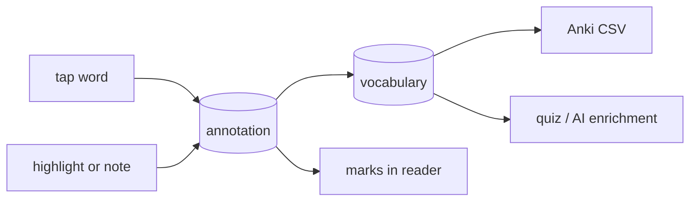

# DuoReader — learning layer

Companion to `DESIGN.md`. `DESIGN.md` stays the reader brief; this file owns the
learning features: capture, lookup, pronunciation, review, and later AI support.
It is a decision document first and an implementation plan second.

**Status:** L0 shipped in 0.15.0; L1 shipped in 0.16.0, its vocabulary records
carry the language pair since 0.17.4; L2's Words screen and Anki CSV shipped in
0.18.0, its word card and jump in 0.19.0; L2 remainder and L3–L5 proposed.
Verified in Chromium and WebKit e2e; device check pending. Last revised
2026-11-25.
**Owner:** the single user of this app; there is no server and no multi-user data.

## 1. Purpose

Turn the bilingual pairs the importer already produces into a learning loop
without turning the reader into a course platform:

1. encounter a word in a sentence,
2. get its meaning and pronunciation in place,
3. keep it with the sentence and translation that gave it meaning,
4. review it outside the app (Anki),
5. optionally deepen it (idioms, usage, quizzes) with AI.

Reading remains the primary activity. Every learning action must be reachable
from the sentence it belongs to, in at most two taps.

## 2. Constraints that shape every decision

| Constraint | Source | Consequence |
|---|---|---|
| Static PWA, no backend | `DESIGN.md` §9 | No server-side dictionary, no hidden API keys, no sync |
| Reading makes zero automatic network requests | §8 | Only explicit user actions may leave the device: the external Define link and later AI requests. Nothing polls or syncs. |
| Cold start ≤ 1 s, shell precached | §8 | No large corpus in the app shell |
| Under 5 MB per book | §8 | Annotations must stay small; images dominate today |
| iOS 17 Safari / Home Screen app | §9 | `Intl.Segmenter`, `caretRangeFromPoint`, `speechSynthesis` available; native selection is quirky |
| Text rendered with `textContent` only | §9 | No `innerHTML` for book text; marks must be built from text nodes |
| Book editions are immutable | §6 | `book.id` is a hash of the source; pair ids come from the publisher |

## 3. The loop



Layers, deliberately separable:

- **Core (offline):** annotations, vocabulary, marks, export. Works with no network and no AI.
- **Enrichment (optional):** TTS (offline), OS dictionary Look Up (offline, native selection), external Define (online), AI (online, opt-in).
- Every enrichment writes back into the core records, so the core never depends on which enrichments are enabled.

## 4. Coordinates and data model

Rendering keeps one text node per side (`pair.source`, `pair.target`). An
annotation stores character offsets into that string, plus the exact captured
text. Offsets survive tokenizer changes; the stored text lets the reader detect
drift after a re-import and skip a mark rather than mis-highlight.

```ts
interface Annotation {
  id: string;                 // crypto.randomUUID()
  bookId: string;             // book-<source hash>; stable for the same ZIP
  chapterIndex: number;
  pairId: string;             // publisher pair id; `text:<path>@<n>` for a plain block
  side: 'source' | 'target';
  start: number;              // character offsets into the pair string
  end: number;
  text: string;               // exact slice, for validation
  kind: 'word' | 'phrase' | 'sentence' | 'passage' | 'note';
  color: 'yellow' | 'green' | 'blue' | 'pink';
  note?: string;
  createdAt: number;
  updatedAt: number;
}

interface VocabularyEntry {
  id: string;
  bookId: string;
  bookTitle: string;          // survives book deletion
  sourceLang: string;         // the book's pair at capture; groups the list
  targetLang: string;
  chapterLabel: string;
  pairId: string;
  side: 'source' | 'target';
  start: number;
  end: number;
  term: string;               // display headword: confirmed lemma, else surface
  surface: string;            // exactly as it appeared in the sentence
  lemma?: string;             // confirmed base form, when one exists
  pos?: string;               // 'verb' | 'noun' | 'adj' | 'adv' | …
  lemmaSource?: 'user' | 'table' | 'ai';
  context: string;            // full source sentence
  translation: string;        // the pair's target sentence
  entry: string;              // optional gloss: typed or copied from a book/AI gloss by the user
  glossSource?: 'user' | 'book' | 'ai';
  glossId?: string;           // the edition gloss this entry came from, when promoted
  status: 'new' | 'learning' | 'exported' | 'known';
  tags: string[];
  createdAt: number;
  exportedAt?: number;
}
```

Storage: IndexedDB **v6** owns `annotations` (key `id`, indexes `by-book`,
`by-book-pair`, `by-book-chapter`), `vocabulary` (key `id`, indexes `by-book`,
`by-book-pair`, `by-term`, `by-status`, `by-languages` =
`[sourceLang, targetLang]`), and `glossaries` (key `bookId`). v3 created
annotations; v4 added the chapter index; v5 added vocabulary and edition
glossaries; v6 put the language pair on every vocabulary record and indexed it.
The reader queries annotations by chapter, so opening a book reads only the
rendered chapter's notes, and it looks a saved word up by `[bookId, pairId]` so
a tap reads only that pair's records. The v1→v2 upgrade test gained v2→v3,
v3→v4, v4→v5, and v5→v6 siblings.

**Why the pair is stored, not joined.** A vocabulary record outlives its book,
so after a deletion there is nothing left to look its languages up from, and a
single reader can hold books in several pairs (`de → en`, `vi → en`,
`zh → vi`). The v5→v6 upgrade reads the surviving `books` rows and fills each
record; a record whose book was already deleted becomes `und`/`und` and is
grouped as *Unknown* rather than borrowing another book's languages. Deleting a
book deletes its annotations and glossary and keeps vocabulary, which carries
its own title, chapter label, and pair.

A plain EPUB block has no publisher pair. The renderer gives every text block a
synthetic pair id, `text:<chapter path>@<block index>`, with the block text as
`source` and an empty `target`. The same annotation record, mark renderer, and
sheet therefore work unchanged; the unit is the block, titled `Passage` rather
than `Sentence`. The id is stable across a reload and a re-import of the same
edition, so a note survives; a changed edition gets a new `book.id` anyway.

### 4.1 Book glosses are edition data

A translation pipeline can ship key-vocabulary glosses with a book. They are
**not** vocabulary records: `vocabulary` is user state — status, notes, tags,
and exports — and importing a book is not a user action. The archive carries
them as `glossary.json` inside `reader-master.epub`, listed in the OPF and not
in the spine, so they are covered by the `book.id` hash: changing a gloss is a
new edition, exactly like changing pinyin.

```ts
interface BookGloss {
  id: string;                 // producer id, or `${pairId}:${start}:${end}`
  pairId: string;             // first occurrence in the text
  side: 'source' | 'target';
  start: number;              // offsets into the pair string, as Annotation
  end: number;
  term: string;               // surface form at that occurrence
  lemma?: string;             // headword to teach
  pos?: string;
  pinyin?: string;            // source-side romanization, when the producer has it
  gloss: string;              // the LLM's meaning, shown verbatim
}
```

The reader parses the file into `Book.glossary` (missing or malformed → no
glosses plus a warning, never a failed import), persists it in `glossaries`,
and deletes it with the book. No vocabulary record is created at import time.
The same rule covers any future producer-authored note or annotation: reference
data, never user state. Cap entries in the parser (e.g. 5,000) so a hostile
archive cannot inflate storage.

## 5. Interaction

- **Word tap (L1, shipped 0.16.0; two segments in 0.17.0):** map the point to
  a character offset (`caretRangeFromPoint`, `caretPositionFromPoint`
  fallback), expand with `Intl.Segmenter` (`granularity: 'word'`) to word
  boundaries, and open a sheet titled with the word. Its two jobs are two
  segments, a segmented control in Apple's sense: **Word** holds the line the
  word sits in, an editable **base form** field (prefilled with the word, or
  the saved lemma when the range was captured before — trim it, do not retype),
  a matching edition gloss, `Highlight word`, and `Save`; **Sentence** holds
  both lines, `Highlight sentence` (or `Highlight passage`), and the note.
  Neither job pushes the other below the fold. `Highlight word` writes a ranged
  annotation; `Save` writes the vocabulary record with the surface form, the
  base form when it differs from the surface (an untouched prefill stores no
  lemma), both sentences, the book's language pair, and the gloss when one
  matched. L0 is therefore not lost, only moved one tap away. Speak and Define
  remain L3/L4.
- **Sentence tap (L0, shipped):** when the caret cannot resolve to a word
  (punctuation, or an engine without `Intl.Segmenter`), the sheet opens at pair
  level with the two lines, `Highlight sentence`, and the note — no segments,
  because there is no word to separate. A gesture longer than 800 ms or moving
  more than 12 px is a selection or a scroll, not a tap; a non-collapsed
  selection is never touched. A plain EPUB has no pairs, so its text-only
  blocks are the unit: the sheet keeps the `Passage` label and highlights or
  notes the whole block.
- **Offline lookup is the OS dictionary.** Native selection stays untouched, so
  select → Look Up opens the iOS dictionary with no network and no app data.
  The app never intercepts the selection menu; it only adds a shortcut path.
- **Define** (online only, L4) opens the external service with the encoded
  word and nothing else. Offline the action is absent rather than disabled.
- A tap after a native selection is ignored while `document.getSelection()` is
  non-empty, so selecting a phrase never pops the learning sheet on top of the
  system menu.
- **Notes:** annotation on the pair, rendered as a dotted underline on the
  sentence and edited in the sheet. A note is an action inside the sheet,
  never a separate gesture.
- No token spans in the DOM: they would break line breaking for long German
  compounds and native selection, for a marginal gain.
- Marks split the text at the stored offsets and wrap the slice in
  `<mark class="reader-mark">`; a word mark is `reader-word`, a sentence
  `reader-highlight`, a note `reader-note`. No `innerHTML` with book text.

### 5.1 Entry points

The system menu is never touched. Our actions live on four app-owned surfaces:

| Surface | Trigger | Actions |
|---|---|---|
| Word sheet (L1, shipped; segments in 0.17.0) | single tap on a word, or on a word mark | `Word` segment: Highlight word, Save (surface + base form), book gloss, one-line context. `Sentence` segment: Highlight sentence/passage, note |
| Sentence/passage sheet (L0) | tap where no word resolves (punctuation, no segmenter) | Highlight sentence/passage, note field; Remove note once stored (no segments) |
| Words screen (L2, shipped 0.18.0) | Library → Words | one card per language pair (count, export date); opening a card pushes that pair's list with search, status chips, and one per-pair CSV export |
| Reader bar | — | Chapters, Aa, Library; no word controls |

Native selection keeps its own menu: long-press or double-tap selects text, and
iOS offers Look Up, Speak, and Copy. The app neither reads nor extends that menu,
so Look Up stays the offline dictionary path and selection never competes with
our sheet.

### 5.2 Tap mechanics

- Open on `click`, and only when the pointer moved less than 12 px and the
  gesture lasted less than 800 ms since `pointerdown`: a scroll and a long press
  are never taps.
- Map the point with `caretRangeFromPoint` (`caretPositionFromPoint` fallback) to
  a text node and a character offset, then add the lengths of the preceding text
  nodes in the same `.src`/`.tgt` line. The `.pinyin` span is skipped. A `<br>`
  contributes no DOM character; `pairTextMap` walks the pair's runs and lets a
  break consume the producer's space when the pair string carries one, so a
  word's stored offsets are always pair coordinates.
- Sentence mode needs no pair range: the pair element under the tap is the
  unit. Paragraph mode joins several pairs and their gaps, so it searches the
  pair ranges (`blockParagraph().ranges`) for the caret offset, then maps the
  local DOM offset to the pair. A gap belongs to no pair; the range boundary
  still resolves to the sentence beside it.
- `Intl.Segmenter(..., { granularity: 'word' })` expands the caret to the word,
  preferring the word ending at a boundary when the caret lands on the
  following space. Without a segmenter or a word-like segment, the word section
  is absent and the sheet stays at sentence/passage level.
- The sheet is a `<dialog>` opened with `showModal()`, like settings, so it
  inherits the sheet rules (`DESIGN.md` §20): no `<select>`, no filter beneath
  it. It closes on backdrop, Escape, or `Done`. The word sheet opens on the
  `Word` segment; the `Sentence` segment is one tap away (`role="tab"`, arrow
  keys and Home/End move between them, the selected one is the tab stop).
  Panels are the same DOM nodes throughout, so switching never loses a typed
  base form or note. `Done` saves the note from either segment; `Save` writes
  the word immediately and keeps the sheet open for a base-form edit.
  `Remove note` deletes the stored note at once, appears only on the `Sentence`
  segment, and is absent when the pair has none.

### 5.3 Vocabulary lives in the Library, one deck per pair

`Save` writes a vocabulary record; the sheet then shows `Saved ✓`. The same
range reopened shows the stored base form and the saved state, and Save updates
that record instead of duplicating it. The full list is a Library sheet
(`Words`, L2, shipped 0.18.0), not a fourth top-bar control: the reading bar
keeps `Chapters · Aa · Library`, and the list is global because each record
carries its own book title, chapter label, and language pair.

**Pairs first.** The sheet opens on one card per language pair the reader has
words in (`German → English`, `Vietnamese → English`, …), largest first, each
with its count and whether it has been exported. Opening a card pushes that
pair's list in the same dialog (`‹ Words` goes back, like the font list):
search over headword, inflected form, gloss, and book title; status chips
(`All`, `New`, `Learning`, `Exported`, `Known`) with counts; rows newest first;
and one footer action, `Export N words as CSV`, covering the current search and
status. Pair selection is navigation, so there is no default group and no extra
stored state.

There is no merged all-languages list. A headword is only meaningful inside its
pair — the same string can be a German noun and a Vietnamese word — and a mixed
list would produce wrong TTS voices, wrong card templates, and wrong dedupe
(`Haus` in German must never merge with an identically spelled word from another
language). Each pair is a deck: one CSV, one card template, one voice. Export
writes the fixed Anki field order, joins the pair's notes into the `Note` field,
and marks the rows `exported` (a reader-set `known` survives), so the card then
shows its export date. A record whose pair could not be recovered (book deleted
before v6) is grouped as *Unknown* and is never folded into a language group.

**A row opens its word card** (0.19.0). The card shows the pair's source with
the captured word marked, its translation, the saved gloss, and the note kept
for that pair (read from `annotations` by `[bookId, pairId]` once the card is
already visible), plus `Go to word`, which opens the book at that pair and
stores it as the reading position. The chapter comes from the pair id, so a
re-import that moved chapters still lands on the right sentence; a plain
passage resolves by its synthetic `text:` id. Back returns to the list with its
search and status intact. Vocabulary outlives its book, so a deleted book leaves
the card readable and says so instead of jumping.

Not in 0.19.0: per-word edit and status changes (`learning`/`known` arrive with
review), the book filter, lemma+POS dedupe, and the glossary `Add all` batch;
apart from Export the list is read-only.

### 5.4 Book glosses in the word sheet

- A tap looks up the edition glosses for that pair: same `pairId` and
  overlapping ranges, else an exact case-insensitive `term` match. No substring
  guessing — a `Haus` gloss must not fire on `Häuser`; languages the segmenter
  splits differently need producer offsets. `glossAt` in
  `src/reader/words.ts` implements it.
- The sheet shows the gloss under the word, muted and labelled `Book gloss`,
  with the lemma and pinyin when the producer supplied them. It stays read-only
  after the word is saved: editing the record never writes back to the edition.
- `Save` copies the gloss into `entry`, the tapped surface into `surface`, the
  pair and both sentences into the record, and sets `glossSource: 'book'` and
  `glossId`. The user's tap is the review step; a gloss never enters vocabulary
  without one.
- A term already saved for that book is shown as saved; promotion never
  overwrites notes, status, tags, or an edited `entry`.
- **Batch** is one explicit action: `Add all N to Words` at the end of the
  glossary chapter. It previews the count, dedupes against saved records, and is
  the only bulk write. Every promoted record inherits the book's
  `sourceLang`/`targetLang`, so a batch lands in that book's group. Import never
  prompts and never writes vocabulary.
- Books from before this format simply have no glosses; nothing changes.

### 5.5 Marks

L0 paints sentence marks; L1 adds ranged word marks. A sentence highlight is a
`reader-highlight` tint on both lines, a note is a `reader-note` dotted
underline, and a captured word is a stronger `reader-word` tint on its side
only. Word marks carry `data-annotation-id`, so tapping one reopens that exact
range and base form; a tap on marked text still maps to the word under the
caret when it is not a word mark. `markClass` and `paintLineMarks` validate the
stored `text` against the pair and skip a drifted mark, so a re-import never
paints the wrong words. The sheet writes each action immediately, but the
chapter repaints when the sheet closes, not while it is open: the story under a
modal is never re-rendered with a thumb on it. `blockParagraph()` returns the
pair ranges used by paragraph mode; a range counts DOM text characters, so a
`<br>` is zero. The sheet uses no `<select>` and inherits the gesture rules in
`DESIGN.md` §20.

## 6. Delivery order

Ordered by impact per unit of work, not by feature list.

| Milestone | Work | Done signal |
|---|---|---|
| **L0 — Annotations core** (shipped 0.15.0) | DB v3, annotation store, sentence sheet, sentence highlight, notes; pair-range marks for paragraph mode | Highlight a pair, add a note, relaunch, both return |
| **L1 — Word capture** (shipped 0.16.0) | DB v5 vocabulary and glossaries; point-to-offset mapping, `Intl.Segmenter` expansion, word highlight and marks, Save with the surface and an editable base form; matching book gloss in the sheet; gloss parser | Tap a German word, see both sentences and its gloss, save it |
| **L2 — Review screen** (shipped 0.18.0) | Words sheet: one card per language pair (largest first, count, export date), a pushed per-pair list with search over headword/surface/gloss/book, status chips, newest-first rows; per-pair CSV with the fixed Anki field order, UTF-8 BOM, notes joined by pair, and `exported` written back (DB v6 `by-languages`) | Save two words in one pair and one in another, open Library → Words, export a pair; the other pair's words stay out of the file, and the exported date survives a reload |
| **L2 remainder** | Per-word edit and status changes (`learning`/`known`), book filter inside a pair, lemma+POS dedupe within the pair, glossary `Add all N` | Mark a word `known` from the list; saving a second occurrence of the same lemma updates one card |
| **L3 — TTS** | `speechSynthesis` for word and sentence, rate and voice choice, stop on navigation | Read a paragraph aloud; word taps speak the word |
| **L4 — Lookup and base forms** | Keep native selection and iOS Look Up unobstructed; add Define (online); optional installable lemma pack offering base-form candidates with POS | Select a word offline → Look Up works; online, Define opens the service; a captured `verflucht` offers `verflucht (adj)` and `verfluchen (verb)` |
| **L5 — AI enrichment** | Explain word, phrase, idiom, usage; quiz items from vocabulary; cached results | Every AI result re-opens offline |

L0–L2 are the core loop. L3–L5 enrich it and can be skipped without breaking it.

## 7. Decision dossiers

Each dossier states the question, the realistic options with pros and cons, a
recommendation, and what it unblocks. Recommendations are defaults, not
commitments; L0 depends on none of them.

### D1. Where does a word gloss come from? (resolved: OS Look Up + online Define)

**Decision, 2026-11-14:** the installed PWA exposes the native selection menu, so
selecting a word and tapping **Look Up** opens the iOS dictionary offline
(verified on the user's device). That closes the offline lookup requirement
without shipping any data. Online, the word sheet adds **Define**, an explicit
external lookup initiated by the user.

| Option | Pros | Cons |
|---|---|---|
| **iOS Look Up on a native selection** (chosen, offline) | Zero data of our own, no licence, system dictionary quality, works in airplane mode, nothing to install in the app | Requires German and English dictionaries to be downloaded in iOS Settings; one long-press away rather than one tap; the app cannot read the result, so the gloss is not captured automatically |
| **External service via Define** (chosen, online) | Current senses and idioms, several providers, already the web's answer | Needs network; leaves the app for Safari; the word leaves the device; no automatic capture |
| **Corpus installed into IndexedDB** | Offline glosses inside the app; no context switch | Licence and build work, 1–3 MB per install, inflection/compound heuristics; duplicates a dictionary iOS already ships |
| **Corpus precached in the app shell** | Offline from first launch, one code path | Adds megabytes to every install and the precache; breaks the 1 s cold start |
| **AI lookup on demand** | Explains context and idioms | Network, cost, privacy; belongs to L5 |
| **No lookup at all** | Zero work | Word-level precision is the point of vocabulary cards |

Behaviour:
- Offline: Look Up only. The sheet has no Define action and says so.
- Online: Define opens `https://www.dict.cc/?s=<encoded word>` in a new tab
  (`noopener`), sending the word and nothing else. The service is one constant;
  changing providers is not a code change.
- The vocabulary card's `Entry` field stays optional: typed by the user, or
  filled by AI in L5. Nothing scrapes the external page.
- **The system dictionary is a UI service, not a data source.** WebKit exposes no
  bridge to it, and even native code has no public API that returns definitions:
  `UIReferenceLibraryViewController` can only test whether a term has an entry
  and display it ([example](https://www.hackingwithswift.com/example-code/uikit/showing-dictionary-definitions-using-uireferencelibraryviewcontroller);
  [no public API](https://stackoverflow.com/questions/7419940/access-ios-dictionary-programmatically)).
  So Look Up helps the reader, never the app: it cannot supply a lemma, senses,
  or POS. Base forms still come from the lemma pack (D3a), the user, or AI.

### D2. Superseded: shipping dictionary data

Recorded so the option is not reopened blindly. With Look Up covering offline
glosses, the app ships no dictionary corpus.

- Corpus sources (Wiktionary-derived CC BY-SA extracts, FreeDict, dict.cc-style
  data, commercial APIs) all cost licence review, an importer, storage per
  device, and a maintenance surface — to duplicate a dictionary iOS already has.
- Revive only if in-app glosses become a requirement while online and Define is
  too slow, or if an offline `Entry` field for cards outweighs the data cost.

### D3. Base forms (lemmatization) for vocabulary cards

Captured words arrive inflected: `Häuser`, `spielte`, `verflucht`. A card is
more useful with the base form (`Haus`, `spielen`, `verfluchen`) plus the
inflected form in context, so lemmatization belongs to capture, not lookup. It
is a data and disambiguation problem, not a library choice:

- German lemmatizers worth using are Python plus data — spaCy's German lemmatizer
  is itself a lookup table (its accuracy is a known weak point), IWNLP and
  GermaLemma rely on Wiktionary/TIGER-derived tables. There is no mature
  browser-native German lemmatizer; JS ports are experiments.
- Ambiguity is part-of-speech ambiguity, not morphology. `verflucht` is a
  lexicalized adjective/adverb *and* the Partizip II of `verfluchen`. Any
  lemmatizer first tags the word, then looks up. Without context it cannot know
  whether the reader met “a damn thing” or “he cursed”; even with context,
  taggers disagree.

| Option | Pros | Cons |
|---|---|---|
| **Surface form only at capture** | Zero data, honest, never wrong | Cards show `Häuser` where `Haus` teaches more |
| **User-entered base form** (chips or one text field) | Zero data, the learner decides, handles `verflucht` perfectly | One extra decision per word; typing on a phone is friction |
| **Installable lemma pack**: surface → candidate `(lemma, pos)` pairs built offline from Wiktionary/UniMorph-style data | Offline, no per-word cost, exposes the ambiguity as a choice, licence can be vetted once | Data size and licence must be measured; still no context, so it can only offer candidates; build script and versioning |
| **In-browser lemmatizer library/WASM** | Single code path, no data install | No mature German implementation; models are tens of MB and slow on phones |
| **Rule heuristics** (participle `ge-…-t`, plural endings) | Zero data | Noisy; produces plausible but wrong bases; needs many caution labels |
| **AI lemmatization with the sentence** | Resolves `verflucht` with context, handles compounds | Network, cost, latency; L5 |
| **Deterministic single answer** (any of the above without a user check) | Fewest taps | Silently teaches the wrong headword and merges unrelated words |

**Recommendation:** never block capture on a lemma. Store the surface form
always; allow a base-form override from the sheet; treat base forms as
*candidates* when data is available, never as facts. Order of enrichment:

1. L1–L2: surface form, plus an optional base-form field the user can fill.
2. L4: optional installable lemma pack, shown as chips (“learn as `verflucht`
   adjective” / “`verfluchen` verb”) with a `table` provenance label. The
   architecture, measured sizes, and data gaps are in D3a; ship only after the
   evaluation gate there passes.
3. L5: AI picks the candidate that fits the sentence and offers inflections.

Dedupe uses `lemma + pos` once a base form is confirmed, otherwise the surface
form; entries are never merged across parts of speech. Record `lemmaSource` so
exports and a future UI can distinguish user-chosen from machine-guessed forms.

### D3a. Offline lemma pack: architectures and measured evidence

Ansatz to build on later; no implementation commitment. Measurements were taken
on 2026-11-15 against [UniMorph German](https://github.com/unimorph/deu)
(CC BY-SA 3.0, derived from English Wiktionary) and the sample book.

**Why the OS dictionary is not a lemma source.** It is tempting to reuse Look Up
instead of shipping data, but it is a native UI service: no WebKit bridge, and
even a Capacitor shell gets only "does this term have a definition" plus a
display view — no API returns the entry text or its headword. The dictionary can
tell the reader that `verflucht` belongs to `verfluchen`; it cannot tell the app.

**Data reality**

| Measure | Value |
|---|---|
| Rows (lemma, surface, features) | 519,143 |
| Distinct surfaces | 206,104 |
| Lemmas | 39,373 |
| Distinct (surface, lemma, POS) | 210,452 |
| Multi-lemma surfaces | 1,726 |
| Raw TSV | 5.23 MB |
| Gzip of entries | 758 KB |
| Gzip of surfaces only | 536 KB |
| Gzip of lemmas only | 150 KB |

Coverage on the German side of the sample book (15,347 source tokens, 2,922
unique): UniMorph matches 47.7% of tokens exactly or after lowercasing. After
removing a closed-class stoplist, 16.8% of tokens are still missing content
words — proper names (`Piranha`, `Anton`), compounds (`Taucherbrille`,
`Wohnwagen`, `Gurkenglas`), adverbs (`wieder`, `dann`, `ganz`) and `wäre`,
because **`sein` is absent from the dataset**. The table is clean but incomplete:
closed-class words and some auxiliaries are missing, and German compounds are
unbounded.

**Architectures**

| Architecture | Build cost | Artifact | Runtime | Accuracy / failure mode | Verdict |
|---|---|---|---|---|---|
| **A. Lemma DAWG (~39k lemmas) + suffix/umlaut rules + irregular table** | DAWG builder, rule table, exceptions compiled from data | Estimate ~150–250 KB (DAWG at 4 bytes/edge); measure | `O(length)` walk, no deps | Regular nouns/adjectives good; strong verbs and participles need an exception table; compounds need splitting; heuristics produce false candidates that must be labelled | Fallback layer for unknowns, not the primary source |
| **B. Surface→lemma FST** built offline with foma/HFST/SFST | Desktop toolchain; transducer runtime absent in JS; Zmorge/Giella data is GPL | Several MB | Need a JS FST runtime (none mature) | Best coverage and exact mapping; still returns several analyses, so POS/context choice remains | Reject for now; record as the accuracy ceiling |
| **C. Exact table + hash (front-coded binary, open addressing, or MPHF)** | Parse data into `(surface → [(lemma, POS)])`; MPHF builder optional | Measured: 758 KB gzip as plain entries, 536 KB surfaces, 150 KB lemmas; MPHF adds ~2–4 bits/key plus the value arrays | Typed arrays or `Map`; `O(1)` or `O(log n)` | Exact for covered forms, no invented lemmas; gaps are data gaps (`sein`, compounds) | **Primary candidate** |
| **D. Rules only, no data** | None | 0 | Trivial | Cannot restore umlauts or strong verbs reliably; noisy | No |

**Corrections to the intuitive model**

- A DAWG that stores a value per word is an MA-FST; Hanov notes the node count
  blows up and recommends a minimal perfect hash *beside* the MA-FSA instead
  ([article](https://stevehanov.ca/blog/compressing-dictionaries-with-a-dawg)).
- MPHF overhead of 2–4 bits/key covers the hash only; the lemma IDs and lemma
  strings are additional, which is why the total lands near 1 MB, not 50 KB.
- Suffix stripping must restore umlauts and inserted letters: `Häusern` → strip
  `-ern` → `Häus` → restore `ä→a` → `Haus`. Strong verbs (`ging` → `gehen`,
  `genommen` → `nehmen`) need a table; rules alone cannot recover them.
- An FST is a relation, not a function: it returns every analysis, so POS
  ambiguity (`verflucht` adjective vs participle) still needs a choice.
- Data gaps beat algorithms: UniMorph has no adjective entry for `verflucht` and
  no `sein` paradigm, so no architecture above can return `sein` from this
  source. Fix the source or add a closed-class table before tuning structures.

**Recommended ansatz**

1. **Exact table first.** Build `(surface → [(lemma, POS)])` from the best
   licensed source, and ship it as the primary lookup. Start with the simplest
   runtime — gzipped entries parsed into a `Map` inside a Web Worker — and only
   consider front-coding or MPHF if memory or latency measurements demand it.
   The gzip artifact is already under 1 MB, and 206k keys do not need O(1).
2. **Rules only as a fallback**, labelled `possible`: compound splitting against
   the lemma set (both parts known, each ≥3 characters), then suffix stripping
   with umlaut restoration, then an irregular table compiled from the same data.
3. **Small closed-class table** (articles, pronouns, auxiliaries including
   `sein`/`war`/`wäre`) so common words resolve even if the main source omits
   them.
4. **Source check before building:** run the same coverage probe against a
   kaikki.org German extract (Wiktionary-derived, CC BY-SA) and compare. Ship
   the source with the best content-word coverage per MB, not the cleanest data.
5. **Interface:** `lemmaCandidates(surface)` returns `{lemma, pos, source:
   'table'|'compound'|'rule'}`; duplicates collapse to `lemma+POS`; UI shows
   chips and never rewrites the surface.

**Runtime and delivery**

- Worker owns decompression, parsing, and lookup; the main thread never blocks.
- Installed on demand (L4), not precached, so the 1 s cold start is unaffected;
  Cache Storage persists the artifact, versioned by `manifest.json` (language,
  source hash, licence, build date).
- Budgets to verify: ≤1 MB gzip, ≤100 ms init, ≤1 ms lookup, ≤15 MB heap.
- Web Worker + typed arrays keep iOS memory comfortable; avoid keeping both the
  raw TSV and the parsed structures.

**Evaluation gate before shipping**

- Coverage probe on 2–3 books: percent of content tokens with a candidate,
  percent with more than one candidate, top missing words by frequency.
- Accuracy spot check: 100 inflected forms against manual lemmas, including
  ambiguous participles/adjectives.
- Size and init time measured on an iPhone, not a desktop.
- If the gate fails, keep the manual base-form field only; the reader does not
  depend on the pack.

**Sources**

- [UniMorph deu](https://github.com/unimorph/deu) — CC BY-SA 3.0, counts above.
- [Compressing dictionaries with a DAWG](https://stevehanov.ca/blog/compressing-dictionaries-with-a-dawg) — MA-FSA construction, 4 bytes/edge, values blow up.
- [PTHash](https://arxiv.org/abs/2104.10402) and CHD/FCH — minimal perfect hashing space/performance.
- [SMORLemma / Zmorge](https://github.com/rsennrich/SMORLemma) and the
  [Giella German FST](http://models.uralicnlp.com/nightly/deu/index.html) — full
  morphological analyzers, GPL, no browser runtime.
- kaikki.org German extract — Wiktionary-derived forms with POS, to evaluate.

### D4. Highlight granularity and model

| Option | Pros | Cons |
|---|---|---|
| **Character offsets into the single text node** | Survives tokenizer changes; cheap; no DOM churn; one code path for word, phrase, sentence | Rendering must split text nodes; overlapping ranges need merging |
| Token spans in the DOM | Trivial hit-testing and styling | Breaks compound line breaking and native selection; tokenizer version becomes a data contract |
| Sentence-only annotations | Simplest possible | Cannot mark a word, which is the core vocabulary action |
| Native Selection API ranges + serialization | Uses the platform | iOS selection UI fights taps; serialization is fragile across re-imports |

**Recommendation:** character offsets (as in §4). Keep sentence annotations as
offsets covering the whole string so one renderer handles every kind.

### D5. Notes

| Option | Pros | Cons |
|---|---|---|
| Sentence-level note in the sheet | Context is the point; one note per pair; simple rendering (margin marker) | Cannot annotate a single word separately |
| Word-level note | Precise | More UI, more overlap rules, marginal value for language learning |
| Free-form book notes / journal | Unbounded expression | Needs a separate editor and navigation; scope creep |
| Export notes with vocabulary | Notes become card backs | Needs field design; long notes bloat cards |

**Recommendation:** sentence-level notes, plain text, capped length (about 500
characters), included in the Anki export as an optional field.

### D6. Where does review happen?

| Option | Pros | Cons |
|---|---|---|
| **Anki export** | Best-in-class SRS, already on the phone, no scheduling code here; one deck per language pair keeps template and voice honest | Requires an export step and an import flow per pair; card quality depends on the template |
| Built-in SRS | Self-contained loop | Scheduling, statistics, notifications, and UI are a project of their own; duplicates Anki |
| Both | Closed loop without leaving the app | Two sources of truth for review state; sync problem |
| No review | Zero work | Captured words never stick; the feature loses its payoff |

**Recommendation:** Anki export for v1, **one CSV and one deck per language
pair**, keeping `status` as `new | learning | exported | known` so an in-app
review mode stays possible later. A reader with German and Vietnamese books gets
two decks, not one merged file: the prompt language, the TTS voice, and often the
card template differ. Do not build an SRS until Anki export has been used for a
while.

### D7. Export format

| Option | Pros | Cons |
|---|---|---|
| **CSV/TSV with a documented field order** | Trivial to build, human-inspectable, imports into Anki desktop and AnkiDroid; no dependencies | AnkiMobile import support needs verification; the user maps fields once; HTML fields must be escaped |
| `.apkg` generated in the browser | One-tap import, note type included | Requires a SQLite writer (about 1 MB of wasm) plus the Anki schema and media handling; heavy for a rare action |
| AnkiConnect | Live sync into a running Anki | Desktop app must be running; no AnkiMobile support; network calls |
| Plain text / Markdown dump | Easiest | Not importable without manual work |
| JSON for a companion script | Exact fidelity | The user needs a script; not practical on iOS |

**Recommendation:** CSV, UTF-8 with BOM, comma-separated, quoted properly,
**one file per language pair**, named
`<source>-<target>-words-<yyyy-mm-dd>.csv` (for example `de-en-words-2026-11-25.csv`).
The pair is the deck, so it is not a CSV column and cannot be accidentally
merged: exporting `de → en` never includes a `vi → en` word. The export covers
the pair as narrowed by the current search and status. **Shipped in 0.18.0** in
that shape (a tab variant remains the fallback if AnkiMobile rejects commas);
AnkiMobile's CSV path is still unverified on the phone, so the first phone import
is the remaining check.

### D8. Anki card design

| Option | Pros | Cons |
|---|---|---|
| **Recognition: word → meaning, context sentence on the front with the word bolded, translation on the back** | Direct match to the reading experience; context teaches usage | Longer cards; the sentence can leak the answer if the translation stays visible |
| Production: translation → word | Trains recall | Harder; more frustrating for a reader |
| Cloze deletion of the word in the sentence | Excellent for grammar and context | Anki note type change; more complex export |
| Reverse cards | Doubles reps | Unrequested for v1 |

Fixed field order for v1: `Word, Surface, Context, Translation, Entry, Book,
Chapter, Created, Note`. `Word` is the confirmed base form when one is set,
otherwise the surface form; `Surface` always carries the inflected form and
`Context` shows it bolded in its sentence. `Entry` is optional: typed in the
sheet, or filled by AI in L5; nothing scrapes the external Look Up page. The
language pair is the deck, not a field: its presence in the filename is what
keeps two languages apart, and a `Word` is exported as a row of a single pair's
CSV. The user maps fields once per deck; the mapping lives in documentation
rather than hard-coded card styling. `Book` lets one deck hold words from
several books read in the same pair. **Shipped 0.18.0** as this exact field
order, with the note annotation joined per pair into `Note`.

### D9. TTS

| Option | Pros | Cons |
|---|---|---|
| **`speechSynthesis` (Web Speech)** | Free, offline with installed voices, no data, works in the PWA | Voice availability varies; some iOS voices need downloading; no control over phoneme accuracy; stops on lock/suspend in some WebKit versions |
| Server TTS (ElevenLabs, Google, Azure) | Best quality, consistent | Network, cost, key exposure, contradicts offline reading |
| Native AVSpeechSynthesizer via Capacitor | Full platform control, background audio | Forces the native shell (M5) |
| No TTS | No cost | Learner loses pronunciation, the highest-value low-cost feature |

**Recommendation:** `speechSynthesis` in L3; sentence-level play plus word tap;
rate in settings; detect missing voices and say so instead of failing silently.
Server TTS only if quality proves unacceptable.

**Device observation, 2026-11-20 — the system Speak item is not a substitute.**
With *Settings › Accessibility › Spoken Content › Speak Selection* on, iOS reads
Chinese source text correctly, but it cannot identify Vietnamese: on a
Vietnamese newspaper page it read the text as an English/Korean mixture — wrong
voice, diacritics not respected — and the app has no say in that choice, because
the system detects the language from the selection and picks the voice. A web
page cannot add a Speak item to that menu (it is WKWebView's edit menu; only a
native app or a Safari App Extension can), so the menu path is a system feature
we neither control nor can improve.

Consequence for L3: the app names the language itself. Set `utterance.lang` per
utterance from `book.sourceLang`/`book.targetLang` (map `vi → vi-VN`,
`zh → zh-CN`, `en → en-US`), select the Vietnamese voice explicitly rather than
trusting detection, and when no Vietnamese voice is installed say so in the UI
instead of reading Vietnamese text with an English voice. Vietnamese books are
therefore the case that rules out "the system item is good enough"; the in-app
player is the only path that gets the voice right. A vocabulary record carries
its pair, so a word played from the Words screen (or a card's audio) names its
voice without any book being open.

### D10. AI access model

| Option | Pros | Cons |
|---|---|---|
| **User-supplied provider key stored locally** | No server, no shared cost, works today, the user controls the provider | Key sits on the device (anyone with the phone can read it); CORS and browser restrictions vary per provider; no revocable quota |
| **Hosted proxy (Worker/function)** | Hides the key, can add limits and caching | A backend to run and pay for; contradicts "static PWA, no backend"; shared-secret handling |
| **Local model in the browser (WebLLM/transformers.js)** | Fully offline, private | Hundreds of MB of weights, slow on phones, battery cost; unrealistic for this device class |
| **No AI** | Zero risk and cost | Loses comprehension, idiom, and quiz features the user asked for |
| **Copy-paste to a chatbot** | Zero integration | Leaves the app, loses context, no cache |

**Recommendation:** user-supplied key, off by default, with a plain-language
privacy screen; store in IndexedDB, never in the service worker cache; use a
provider whose browser CORS policy works without a proxy (validate before L5).
Settings expose model and a per-request token cap.

### D11. AI feature scope and order

| Feature | Value | Risk | Order |
|---|---|---|---|
| Word/phrase explanation in context | High: fills the dictionary gap for idioms and usage | Hallucinated nuances; cost | First |
| Usage examples and register notes | Medium: aids production | Overlaps dictionary | Second |
| Idiom detection on a phrase | High for literature | Detection needs context; false positives | Third |
| Quiz generation from vocabulary | High: active recall | Wrong answers teach wrong things; review quality | Fourth, after a caching layer exists |
| Comprehension questions per chapter | Medium: checks reading | The user reads for pleasure, not testing | Optional |
| "Interesting tidbit" about a passage | Low: entertainment | Noise, cost | Last, or never |

**Recommendation:** ship word/phrase explanation first, cached by
`hash(model + prompt version + text + both sentences)`, then idioms, then
quizzes. Never generate facts about the book that are not in the text.

### D12. Privacy and network policy

| Option | Pros | Cons |
|---|---|---|
| **Strict offline: no network after install** | Keeps the strongest promise; predictable | Excludes Define and AI, the only features that need a network |
| **Explicit, per-feature network actions** | Offline reading stays the default; user sees every request | Needs UI discipline and a visible network indicator |
| **Background network allowed** | Simpler features | Breaks the trust promise; surprises on metered/roaming |

**Recommendation:** "reading makes zero automatic network requests"; the only
egress is an explicit action — Define (external lookup) and later AI — with the
action visible in the sheet. Offline, Define is absent. `DESIGN.md` §8 already
carries this wording.

### D13. Storage budget

| Data | Estimate | Mitigation |
|---|---|---|
| Annotation | 200–400 bytes | None needed until tens of thousands |
| Note text | up to 500 characters | Cap at input |
| Vocabulary entry | 300–800 bytes with sentences | Dedupe by lemma+POS when a base form is confirmed, else surface; cap context length |
| Book glossary | ~150–300 bytes per entry | First occurrences only, producer cap, parser cap 5,000; deleted with the book, never copied into vocabulary |
| Lemma pack | ~760 KB gzip measured; target ≤1 MB | On-demand install, not precached; one language at a time |
| AI cache | 1–4 KB per explanation | Evict oldest beyond a cap (for example 5 MB) |

Measure at L0 with the sample book; surface `navigator.storage.estimate()` in
settings when storage exceeds half the quota.

### D14. How does the app treat an LLM-authored glossary?

| Option | Pros | Cons |
|---|---|---|
| **Edition reference + explicit promotion** (chosen) | The pipeline's work is visible in place; user state stays truthful; one tap saves with the real sentence; deleting a book leaves no orphan records; `glossSource` keeps provenance | Each word is a tap, or one deliberate batch; a second data layer to parse and store |
| Auto-import on book import | Zero-friction deck; a graded reader's key words are the study set | Writes user state without an action; statuses and Anki exports inherit unreviewed LLM errors; vocabulary survives book deletion, so orphans accumulate; re-imports and editions duplicate; glossary entries often lack the sentence a card needs |
| Auto-import as `suggested` records | Same convenience; statuses stay separate | Two classes of records in one store; dedupe against real saves is ambiguous; filters, counts, and export all need the distinction; promotion is still a write |
| Ignore it; capture only by selection | No format, parser, or storage work | Throws the pipeline's output away; selection capture is slower and only yields offsets after the system menu; a graded reader's key words are the point |
| Render glosses inline in the text | Visible where encountered | Clutters reading, changes line breaking, and still needs a save path; the glossary chapter already covers reading |

**Recommendation:** parse the glossary automatically, show it automatically,
and promote it only on an explicit user action. Auto-import fails on state
ownership: `status`, notes, tags, and Anki export are the user's, and an import
is not a review. The gloss is still one tap away, and `Add all N` covers the
graded-reader case without pretending the user confirmed 300 LLM entries.

## 8. Risks

| Risk | Mitigation |
|---|---|
| Caret mapping misreads a tap in paragraph mode | Verified in Chromium and WebKit e2e; device test at L1; sentence mode needs only the pair element |
| A tap opens the sheet after a long-press selection | Taps are ignored while a selection is non-empty, and a gesture over 800 ms or 12 px is rejected; device check pending |
| Marks fight hyphenation or line breaking | `<mark>` inherits text and carries no layout; verify long compounds at 390 px |
| Re-import changes ids | Store text with every annotation; skip and count unmatched marks |
| Annotation growth against the 5 MB budget | Offsets and short notes are small; measure at L0 |
| An LLM glossary is wrong, stale, or misaligned | Shown as read-only reference with `Book gloss` provenance; a tap is the review; `glossSource` lets an export exclude unreviewed entries |
| A glossary re-import creates a new edition id | Expected: glosses are hashed with the book like pinyin; saved vocabulary keeps the old `bookId` and survives, gloss references do not |
| iOS Look Up missing because no dictionary is installed | The sheet names the requirement; install German and English dictionaries in iOS Settings |
| External lookup URL changes or blocks the word | One constant, URL-encoded word only, no other data sent |
| A wrong lemma or POS merge teaches the wrong headword | Base forms are candidates; `lemmaSource` recorded; never merge across POS; the user can edit |
| One word list mixes languages: the same headword has two pronunciations and two card templates | Pair stored on every record and indexed `by-languages`; the Words screen, dedupe, and export are scoped to the selected pair; orphaned legacy records are `und`, never folded in |
| Lemma pack misses common words (`sein`, compounds) | Coverage probe before shipping; closed-class table; compound splitting; try a fuller source |
| TTS voice availability | Detect and explain |
| AI hallucination and cost | Off by default, cached, per-request cap, no book facts not in the text |
| AI key exposure | Local only, privacy screen, no key in logs or sync |

## 9. Open decisions

D1–D2 are resolved (OS Look Up offline, Define online, no shipped dictionary
corpus). D3 narrowed to one question: whether an offline lemma pack is shipped
alongside the manual base-form field. What remains:

| # | Question | Recommended default | Blocks | Reversible? |
|---|---|---|---|---|
| D3 | Lemma source | Exact table as in D3a (primary), rules only for unknowns; manual base form works without any pack | L4 | Yes |
| D6 | Review location | Anki export, one deck per language pair; status field leaves room for in-app review — shipped 0.18.0 | — | Yes |
| D7 | Export format | CSV per pair — shipped 0.18.0; AnkiMobile import still to check on the phone | — | Yes |
| D8 | Card design | Fixed field order, context with bolded word — shipped 0.18.0 | — | Yes |
| D9 | TTS engine | `speechSynthesis` | L3 | Yes |
| D10 | AI access | User-supplied key, off by default | L5 | Yes |
| D11 | AI first feature | Word/phrase explanation with cache | L5 | Yes |

Nothing above blocks L0 or L1 except the tap-mapping device test.
