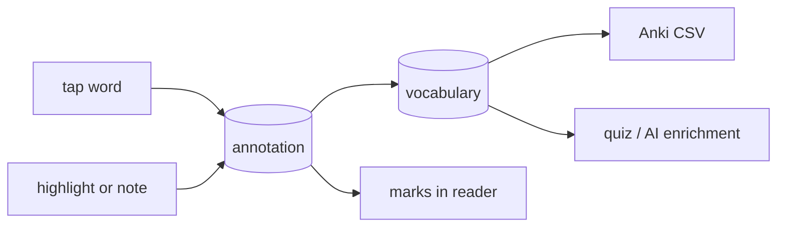

# DuoReader — learning layer

Companion to `DESIGN.md`. `DESIGN.md` stays the reader brief; this file owns the
learning features: capture, lookup, pronunciation, review, and later AI support.
It is a decision document first and an implementation plan second.

**Status:** proposed, nothing implemented. Last revised 2026-11-14.
**Owner:** the single user of this app; there is no server and no multi-user data.

## 1. Purpose

Turn the bilingual pairs the importer already produces into a learning loop
without turning the reader into a course platform:

1. encounter a word in a sentence,
2. get its meaning and pronunciation in place,
3. keep it with the sentence and translation that gave it meaning,
4. review it outside the app (Anki),
5. optionally deepen it (idioms, usage, quizzes) with AI.

Reading remains the primary activity. Every learning action must be reachable
from the sentence it belongs to, in at most two taps.

## 2. Constraints that shape every decision

| Constraint | Source | Consequence |
|---|---|---|
| Static PWA, no backend | `DESIGN.md` §9 | No server-side dictionary, no hidden API keys, no sync |
| Reading makes zero automatic network requests | §8 | Only explicit user actions may leave the device: the external Define link and later AI requests. Nothing polls or syncs. |
| Cold start ≤ 1 s, shell precached | §8 | No large corpus in the app shell |
| Under 5 MB per book | §8 | Annotations must stay small; images dominate today |
| iOS 17 Safari / Home Screen app | §9 | `Intl.Segmenter`, `caretRangeFromPoint`, `speechSynthesis` available; native selection is quirky |
| Text rendered with `textContent` only | §9 | No `innerHTML` for book text; marks must be built from text nodes |
| Book editions are immutable | §6 | `book.id` is a hash of the source; pair ids come from the publisher |

## 3. The loop



Layers, deliberately separable:

- **Core (offline):** annotations, vocabulary, marks, export. Works with no network and no AI.
- **Enrichment (optional):** TTS (offline), OS dictionary Look Up (offline, native selection), external Define (online), AI (online, opt-in).
- Every enrichment writes back into the core records, so the core never depends on which enrichments are enabled.

## 4. Coordinates and data model

Rendering keeps one text node per side (`pair.source`, `pair.target`). An
annotation stores character offsets into that string, plus the exact captured
text. Offsets survive tokenizer changes; the stored text lets the reader detect
drift after a re-import and skip a mark rather than mis-highlight.

```ts
interface Annotation {
  id: string;                 // crypto.randomUUID()
  bookId: string;             // book-<source hash>; stable for the same ZIP
  chapterIndex: number;
  pairId: string;             // publisher pair id
  side: 'source' | 'target';
  start: number;              // character offsets into the pair string
  end: number;
  text: string;               // exact slice, for validation
  kind: 'word' | 'phrase' | 'sentence' | 'note';
  color: 'yellow' | 'green' | 'blue' | 'pink';
  note?: string;
  createdAt: number;
  updatedAt: number;
}

interface VocabularyEntry {
  id: string;
  bookId: string;
  bookTitle: string;          // survives book deletion
  chapterLabel: string;
  pairId: string;
  side: 'source' | 'target';
  start: number;
  end: number;
  term: string;               // display headword: confirmed lemma, else surface
  surface: string;            // exactly as it appeared in the sentence
  lemma?: string;             // confirmed base form, when one exists
  pos?: string;               // 'verb' | 'noun' | 'adj' | 'adv' | …
  lemmaSource?: 'user' | 'table' | 'ai';
  context: string;            // full source sentence
  translation: string;        // the pair's target sentence
  entry: string;              // optional gloss: typed or AI-filled, never scraped
  status: 'new' | 'learning' | 'exported' | 'known';
  tags: string[];
  createdAt: number;
  exportedAt?: number;
}
```

Storage: IndexedDB v3 with `annotations` (key `id`, indexes `by-book`,
`by-book-pair`) and `vocabulary` (key `id`, indexes `by-book`, `by-term`,
`by-status`). Existing stores are untouched; the v1→v2 upgrade test gains a
v2→v3 sibling. Deleting a book deletes its annotations and keeps vocabulary,
which carries its own title and chapter label.

## 5. Interaction

- **Word tap:** map the point to a character offset (`caretRangeFromPoint`,
  `caretPositionFromPoint` fallback), expand with `Intl.Segmenter`
  (`granularity: 'word'`) to word boundaries, open a bottom sheet with the
  word, both sentences, and actions: Speak, Highlight, Save, Note, plus
  **Define** when online. The sheet carries a one-line **base form** field
  (`lemma`, optional POS) so a card can teach `verfluchen` while the context
  keeps `verflucht`.
- **Offline lookup is the OS dictionary.** Native selection stays untouched, so
  select → Look Up opens the iOS dictionary with no network and no app data.
  The app never intercepts the selection menu; it only adds a shortcut path.
- **Define** (online only) opens the external service with the encoded word and
  nothing else. Offline the action is absent rather than disabled, and the sheet
  points at Look Up instead.
- A tap after a native selection is ignored while `textSelection` is non-empty,
  so selecting a phrase never pops the learning sheet on top of the system menu.
- **Sentence:** the same sheet at pair level, with sentence highlight and the
  pair's own translation.
- **Notes:** sentence-level annotation rendered as a margin marker; edited in
  the sheet.
- No token spans in the DOM: they would break line breaking for long German
  compounds and native selection, for a marginal gain.
- Marks split the single text node at the stored offsets and wrap the slice in
  `<mark>`; no `innerHTML` with book text.

## 6. Delivery order

Ordered by impact per unit of work, not by feature list.

| Milestone | Work | Done signal |
|---|---|---|
| **L0 — Annotations core** | DB v3, annotation store, bottom sheet, sentence highlight, notes | Highlight a pair, add a note, relaunch, both return |
| **L1 — Word capture** | Point-to-offset mapping, word expansion, word highlight, save to vocabulary with the surface form and an editable base form | Tap a German word, see both sentences, save it |
| **L2 — Review loop** | Vocabulary screen (search, filter by status/book), dedupe by lemma+POS when set, CSV export with an Anki preset; card headword is the base form if set, else the surface | Export a book's words, import into Anki, fields and umlauts intact |
| **L3 — TTS** | `speechSynthesis` for word and sentence, rate and voice choice, stop on navigation | Read a paragraph aloud; word taps speak the word |
| **L4 — Lookup and base forms** | Keep native selection and iOS Look Up unobstructed; add Define (online); optional installable lemma pack offering base-form candidates with POS | Select a word offline → Look Up works; online, Define opens the service; a captured `verflucht` offers `verflucht (adj)` and `verfluchen (verb)` |
| **L5 — AI enrichment** | Explain word, phrase, idiom, usage; quiz items from vocabulary; cached results | Every AI result re-opens offline |

L0–L2 are the core loop. L3–L5 enrich it and can be skipped without breaking it.

## 7. Decision dossiers

Each dossier states the question, the realistic options with pros and cons, a
recommendation, and what it unblocks. Recommendations are defaults, not
commitments; L0 depends on none of them.

### D1. Where does a word gloss come from? (resolved: OS Look Up + online Define)

**Decision, 2026-11-14:** the installed PWA exposes the native selection menu, so
selecting a word and tapping **Look Up** opens the iOS dictionary offline
(verified on the user's device). That closes the offline lookup requirement
without shipping any data. Online, the word sheet adds **Define**, an explicit
external lookup initiated by the user.

| Option | Pros | Cons |
|---|---|---|
| **iOS Look Up on a native selection** (chosen, offline) | Zero data of our own, no licence, system dictionary quality, works in airplane mode, nothing to install in the app | Requires German and English dictionaries to be downloaded in iOS Settings; one long-press away rather than one tap; the app cannot read the result, so the gloss is not captured automatically |
| **External service via Define** (chosen, online) | Current senses and idioms, several providers, already the web's answer | Needs network; leaves the app for Safari; the word leaves the device; no automatic capture |
| **Corpus installed into IndexedDB** | Offline glosses inside the app; no context switch | Licence and build work, 1–3 MB per install, inflection/compound heuristics; duplicates a dictionary iOS already ships |
| **Corpus precached in the app shell** | Offline from first launch, one code path | Adds megabytes to every install and the precache; breaks the 1 s cold start |
| **AI lookup on demand** | Explains context and idioms | Network, cost, privacy; belongs to L5 |
| **No lookup at all** | Zero work | Word-level precision is the point of vocabulary cards |

Behaviour:
- Offline: Look Up only. The sheet has no Define action and says so.
- Online: Define opens `https://www.dict.cc/?s=<encoded word>` in a new tab
  (`noopener`), sending the word and nothing else. The service is one constant;
  changing providers is not a code change.
- The vocabulary card's `Entry` field stays optional: typed by the user, or
  filled by AI in L5. Nothing scrapes the external page.

### D2. Superseded: shipping dictionary data

Recorded so the option is not reopened blindly. With Look Up covering offline
glosses, the app ships no dictionary corpus.

- Corpus sources (Wiktionary-derived CC BY-SA extracts, FreeDict, dict.cc-style
  data, commercial APIs) all cost licence review, an importer, storage per
  device, and a maintenance surface — to duplicate a dictionary iOS already has.
- Revive only if in-app glosses become a requirement while online and Define is
  too slow, or if an offline `Entry` field for cards outweighs the data cost.

### D3. Base forms (lemmatization) for vocabulary cards

Captured words arrive inflected: `Häuser`, `spielte`, `verflucht`. A card is
more useful with the base form (`Haus`, `spielen`, `verfluchen`) plus the
inflected form in context, so lemmatization belongs to capture, not lookup. It
is a data and disambiguation problem, not a library choice:

- German lemmatizers worth using are Python plus data — spaCy's German lemmatizer
  is itself a lookup table (its accuracy is a known weak point), IWNLP and
  GermaLemma rely on Wiktionary/TIGER-derived tables. There is no mature
  browser-native German lemmatizer; JS ports are experiments.
- Ambiguity is part-of-speech ambiguity, not morphology. `verflucht` is a
  lexicalized adjective/adverb *and* the Partizip II of `verfluchen`. Any
  lemmatizer first tags the word, then looks up. Without context it cannot know
  whether the reader met “a damn thing” or “he cursed”; even with context,
  taggers disagree.

| Option | Pros | Cons |
|---|---|---|
| **Surface form only at capture** | Zero data, honest, never wrong | Cards show `Häuser` where `Haus` teaches more |
| **User-entered base form** (chips or one text field) | Zero data, the learner decides, handles `verflucht` perfectly | One extra decision per word; typing on a phone is friction |
| **Installable lemma pack**: surface → candidate `(lemma, pos)` pairs built offline from Wiktionary/UniMorph-style data | Offline, no per-word cost, exposes the ambiguity as a choice, licence can be vetted once | Data size and licence must be measured; still no context, so it can only offer candidates; build script and versioning |
| **In-browser lemmatizer library/WASM** | Single code path, no data install | No mature German implementation; models are tens of MB and slow on phones |
| **Rule heuristics** (participle `ge-…-t`, plural endings) | Zero data | Noisy; produces plausible but wrong bases; needs many caution labels |
| **AI lemmatization with the sentence** | Resolves `verflucht` with context, handles compounds | Network, cost, latency; L5 |
| **Deterministic single answer** (any of the above without a user check) | Fewest taps | Silently teaches the wrong headword and merges unrelated words |

**Recommendation:** never block capture on a lemma. Store the surface form
always; allow a base-form override from the sheet; treat base forms as
*candidates* when data is available, never as facts. Order of enrichment:

1. L1–L2: surface form, plus an optional base-form field the user can fill.
2. L4: optional installable lemma pack, shown as chips (“learn as `verflucht`
   adjective” / “`verfluchen` verb”) with a `table` provenance label. The
   architecture, measured sizes, and data gaps are in D3a; ship only after the
   evaluation gate there passes.
3. L5: AI picks the candidate that fits the sentence and offers inflections.

Dedupe uses `lemma + pos` once a base form is confirmed, otherwise the surface
form; entries are never merged across parts of speech. Record `lemmaSource` so
exports and a future UI can distinguish user-chosen from machine-guessed forms.

### D3a. Offline lemma pack: architectures and measured evidence

Ansatz to build on later; no implementation commitment. Measurements were taken
on 2026-11-15 against [UniMorph German](https://github.com/unimorph/deu)
(CC BY-SA 3.0, derived from English Wiktionary) and the sample book.

**Data reality**

| Measure | Value |
|---|---|
| Rows (lemma, surface, features) | 519,143 |
| Distinct surfaces | 206,104 |
| Lemmas | 39,373 |
| Distinct (surface, lemma, POS) | 210,452 |
| Multi-lemma surfaces | 1,726 |
| Raw TSV | 5.23 MB |
| Gzip of entries | 758 KB |
| Gzip of surfaces only | 536 KB |
| Gzip of lemmas only | 150 KB |

Coverage on the German side of the sample book (15,347 source tokens, 2,922
unique): UniMorph matches 47.7% of tokens exactly or after lowercasing. After
removing a closed-class stoplist, 16.8% of tokens are still missing content
words — proper names (`Piranha`, `Anton`), compounds (`Taucherbrille`,
`Wohnwagen`, `Gurkenglas`), adverbs (`wieder`, `dann`, `ganz`) and `wäre`,
because **`sein` is absent from the dataset**. The table is clean but incomplete:
closed-class words and some auxiliaries are missing, and German compounds are
unbounded.

**Architectures**

| Architecture | Build cost | Artifact | Runtime | Accuracy / failure mode | Verdict |
|---|---|---|---|---|---|
| **A. Lemma DAWG (~39k lemmas) + suffix/umlaut rules + irregular table** | DAWG builder, rule table, exceptions compiled from data | Estimate ~150–250 KB (DAWG at 4 bytes/edge); measure | `O(length)` walk, no deps | Regular nouns/adjectives good; strong verbs and participles need an exception table; compounds need splitting; heuristics produce false candidates that must be labelled | Fallback layer for unknowns, not the primary source |
| **B. Surface→lemma FST** built offline with foma/HFST/SFST | Desktop toolchain; transducer runtime absent in JS; Zmorge/Giella data is GPL | Several MB | Need a JS FST runtime (none mature) | Best coverage and exact mapping; still returns several analyses, so POS/context choice remains | Reject for now; record as the accuracy ceiling |
| **C. Exact table + hash (front-coded binary, open addressing, or MPHF)** | Parse data into `(surface → [(lemma, POS)])`; MPHF builder optional | Measured: 758 KB gzip as plain entries, 536 KB surfaces, 150 KB lemmas; MPHF adds ~2–4 bits/key plus the value arrays | Typed arrays or `Map`; `O(1)` or `O(log n)` | Exact for covered forms, no invented lemmas; gaps are data gaps (`sein`, compounds) | **Primary candidate** |
| **D. Rules only, no data** | None | 0 | Trivial | Cannot restore umlauts or strong verbs reliably; noisy | No |

**Corrections to the intuitive model**

- A DAWG that stores a value per word is an MA-FST; Hanov notes the node count
  blows up and recommends a minimal perfect hash *beside* the MA-FSA instead
  ([article](https://stevehanov.ca/blog/compressing-dictionaries-with-a-dawg)).
- MPHF overhead of 2–4 bits/key covers the hash only; the lemma IDs and lemma
  strings are additional, which is why the total lands near 1 MB, not 50 KB.
- Suffix stripping must restore umlauts and inserted letters: `Häusern` → strip
  `-ern` → `Häus` → restore `ä→a` → `Haus`. Strong verbs (`ging` → `gehen`,
  `genommen` → `nehmen`) need a table; rules alone cannot recover them.
- An FST is a relation, not a function: it returns every analysis, so POS
  ambiguity (`verflucht` adjective vs participle) still needs a choice.
- Data gaps beat algorithms: UniMorph has no adjective entry for `verflucht` and
  no `sein` paradigm, so no architecture above can return `sein` from this
  source. Fix the source or add a closed-class table before tuning structures.

**Recommended ansatz**

1. **Exact table first.** Build `(surface → [(lemma, POS)])` from the best
   licensed source, and ship it as the primary lookup. Start with the simplest
   runtime — gzipped entries parsed into a `Map` inside a Web Worker — and only
   consider front-coding or MPHF if memory or latency measurements demand it.
   The gzip artifact is already under 1 MB, and 206k keys do not need O(1).
2. **Rules only as a fallback**, labelled `possible`: compound splitting against
   the lemma set (both parts known, each ≥3 characters), then suffix stripping
   with umlaut restoration, then an irregular table compiled from the same data.
3. **Small closed-class table** (articles, pronouns, auxiliaries including
   `sein`/`war`/`wäre`) so common words resolve even if the main source omits
   them.
4. **Source check before building:** run the same coverage probe against a
   kaikki.org German extract (Wiktionary-derived, CC BY-SA) and compare. Ship
   the source with the best content-word coverage per MB, not the cleanest data.
5. **Interface:** `lemmaCandidates(surface)` returns `{lemma, pos, source:
   'table'|'compound'|'rule'}`; duplicates collapse to `lemma+POS`; UI shows
   chips and never rewrites the surface.

**Runtime and delivery**

- Worker owns decompression, parsing, and lookup; the main thread never blocks.
- Installed on demand (L4), not precached, so the 1 s cold start is unaffected;
  Cache Storage persists the artifact, versioned by `manifest.json` (language,
  source hash, licence, build date).
- Budgets to verify: ≤1 MB gzip, ≤100 ms init, ≤1 ms lookup, ≤15 MB heap.
- Web Worker + typed arrays keep iOS memory comfortable; avoid keeping both the
  raw TSV and the parsed structures.

**Evaluation gate before shipping**

- Coverage probe on 2–3 books: percent of content tokens with a candidate,
  percent with more than one candidate, top missing words by frequency.
- Accuracy spot check: 100 inflected forms against manual lemmas, including
  ambiguous participles/adjectives.
- Size and init time measured on an iPhone, not a desktop.
- If the gate fails, keep the manual base-form field only; the reader does not
  depend on the pack.

**Sources**

- [UniMorph deu](https://github.com/unimorph/deu) — CC BY-SA 3.0, counts above.
- [Compressing dictionaries with a DAWG](https://stevehanov.ca/blog/compressing-dictionaries-with-a-dawg) — MA-FSA construction, 4 bytes/edge, values blow up.
- [PTHash](https://arxiv.org/abs/2104.10402) and CHD/FCH — minimal perfect hashing space/performance.
- [SMORLemma / Zmorge](https://github.com/rsennrich/SMORLemma) and the
  [Giella German FST](http://models.uralicnlp.com/nightly/deu/index.html) — full
  morphological analyzers, GPL, no browser runtime.
- kaikki.org German extract — Wiktionary-derived forms with POS, to evaluate.

### D4. Highlight granularity and model

| Option | Pros | Cons |
|---|---|---|
| **Character offsets into the single text node** | Survives tokenizer changes; cheap; no DOM churn; one code path for word, phrase, sentence | Rendering must split text nodes; overlapping ranges need merging |
| Token spans in the DOM | Trivial hit-testing and styling | Breaks compound line breaking and native selection; tokenizer version becomes a data contract |
| Sentence-only annotations | Simplest possible | Cannot mark a word, which is the core vocabulary action |
| Native Selection API ranges + serialization | Uses the platform | iOS selection UI fights taps; serialization is fragile across re-imports |

**Recommendation:** character offsets (as in §4). Keep sentence annotations as
offsets covering the whole string so one renderer handles every kind.

### D5. Notes

| Option | Pros | Cons |
|---|---|---|
| Sentence-level note in the sheet | Context is the point; one note per pair; simple rendering (margin marker) | Cannot annotate a single word separately |
| Word-level note | Precise | More UI, more overlap rules, marginal value for language learning |
| Free-form book notes / journal | Unbounded expression | Needs a separate editor and navigation; scope creep |
| Export notes with vocabulary | Notes become card backs | Needs field design; long notes bloat cards |

**Recommendation:** sentence-level notes, plain text, capped length (about 500
characters), included in the Anki export as an optional field.

### D6. Where does review happen?

| Option | Pros | Cons |
|---|---|---|
| **Anki export** | Best-in-class SRS, already on the phone, no scheduling code here | Requires an export step and an import flow; card quality depends on the template |
| Built-in SRS | Self-contained loop | Scheduling, statistics, notifications, and UI are a project of their own; duplicates Anki |
| Both | Closed loop without leaving the app | Two sources of truth for review state; sync problem |
| No review | Zero work | Captured words never stick; the feature loses its payoff |

**Recommendation:** Anki export for v1, keeping `status` as `new | learning |
exported | known` so an in-app review mode stays possible later. Do not build an
SRS until Anki export has been used for a while.

### D7. Export format

| Option | Pros | Cons |
|---|---|---|
| **CSV/TSV with a documented field order** | Trivial to build, human-inspectable, imports into Anki desktop and AnkiDroid; no dependencies | AnkiMobile import support needs verification; the user maps fields once; HTML fields must be escaped |
| `.apkg` generated in the browser | One-tap import, note type included | Requires a SQLite writer (about 1 MB of wasm) plus the Anki schema and media handling; heavy for a rare action |
| AnkiConnect | Live sync into a running Anki | Desktop app must be running; no AnkiMobile support; network calls |
| Plain text / Markdown dump | Easiest | Not importable without manual work |
| JSON for a companion script | Exact fidelity | The user needs a script; not practical on iOS |

**Recommendation:** CSV/TSV, UTF-8 with BOM, comma or tab selectable, quoted
properly. Verify AnkiMobile's CSV path on the phone before L2 ships; if it fails,
offer a second plain-text export the user can paste into Anki desktop.

### D8. Anki card design

| Option | Pros | Cons |
|---|---|---|
| **Recognition: word → meaning, context sentence on the front with the word bolded, translation on the back** | Direct match to the reading experience; context teaches usage | Longer cards; the sentence can leak the answer if the translation stays visible |
| Production: translation → word | Trains recall | Harder; more frustrating for a reader |
| Cloze deletion of the word in the sentence | Excellent for grammar and context | Anki note type change; more complex export |
| Reverse cards | Doubles reps | Unrequested for v1 |

Fixed field order for v1: `Word, Surface, Context, Translation, Entry, Book,
Chapter, Created, Note`. `Word` is the confirmed base form when one is set,
otherwise the surface form; `Surface` always carries the inflected form and
`Context` shows it bolded in its sentence. `Entry` is optional: typed in the
sheet, or filled by AI in L5; nothing scrapes the external Look Up page. The
user maps fields once in Anki; the mapping lives in documentation rather than
hard-coded card styling.

### D9. TTS

| Option | Pros | Cons |
|---|---|---|
| **`speechSynthesis` (Web Speech)** | Free, offline with installed voices, no data, works in the PWA | Voice availability varies; some iOS voices need downloading; no control over phoneme accuracy; stops on lock/suspend in some WebKit versions |
| Server TTS (ElevenLabs, Google, Azure) | Best quality, consistent | Network, cost, key exposure, contradicts offline reading |
| Native AVSpeechSynthesizer via Capacitor | Full platform control, background audio | Forces the native shell (M5) |
| No TTS | No cost | Learner loses pronunciation, the highest-value low-cost feature |

**Recommendation:** `speechSynthesis` in L3; sentence-level play plus word tap;
rate in settings; detect missing voices and say so instead of failing silently.
Server TTS only if quality proves unacceptable.

### D10. AI access model

| Option | Pros | Cons |
|---|---|---|
| **User-supplied provider key stored locally** | No server, no shared cost, works today, the user controls the provider | Key sits on the device (anyone with the phone can read it); CORS and browser restrictions vary per provider; no revocable quota |
| **Hosted proxy (Worker/function)** | Hides the key, can add limits and caching | A backend to run and pay for; contradicts "static PWA, no backend"; shared-secret handling |
| **Local model in the browser (WebLLM/transformers.js)** | Fully offline, private | Hundreds of MB of weights, slow on phones, battery cost; unrealistic for this device class |
| **No AI** | Zero risk and cost | Loses comprehension, idiom, and quiz features the user asked for |
| **Copy-paste to a chatbot** | Zero integration | Leaves the app, loses context, no cache |

**Recommendation:** user-supplied key, off by default, with a plain-language
privacy screen; store in IndexedDB, never in the service worker cache; use a
provider whose browser CORS policy works without a proxy (validate before L5).
Settings expose model and a per-request token cap.

### D11. AI feature scope and order

| Feature | Value | Risk | Order |
|---|---|---|---|
| Word/phrase explanation in context | High: fills the dictionary gap for idioms and usage | Hallucinated nuances; cost | First |
| Usage examples and register notes | Medium: aids production | Overlaps dictionary | Second |
| Idiom detection on a phrase | High for literature | Detection needs context; false positives | Third |
| Quiz generation from vocabulary | High: active recall | Wrong answers teach wrong things; review quality | Fourth, after a caching layer exists |
| Comprehension questions per chapter | Medium: checks reading | The user reads for pleasure, not testing | Optional |
| "Interesting tidbit" about a passage | Low: entertainment | Noise, cost | Last, or never |

**Recommendation:** ship word/phrase explanation first, cached by
`hash(model + prompt version + text + both sentences)`, then idioms, then
quizzes. Never generate facts about the book that are not in the text.

### D12. Privacy and network policy

| Option | Pros | Cons |
|---|---|---|
| **Strict offline: no network after install** | Keeps the strongest promise; predictable | Excludes Define and AI, the only features that need a network |
| **Explicit, per-feature network actions** | Offline reading stays the default; user sees every request | Needs UI discipline and a visible network indicator |
| **Background network allowed** | Simpler features | Breaks the trust promise; surprises on metered/roaming |

**Recommendation:** "reading makes zero automatic network requests"; the only
egress is an explicit action — Define (external lookup) and later AI — with the
action visible in the sheet. Offline, Define is absent. `DESIGN.md` §8 already
carries this wording.

### D13. Storage budget

| Data | Estimate | Mitigation |
|---|---|---|
| Annotation | 200–400 bytes | None needed until tens of thousands |
| Note text | up to 500 characters | Cap at input |
| Vocabulary entry | 300–800 bytes with sentences | Dedupe by lemma+POS when a base form is confirmed, else surface; cap context length |
| Lemma pack | ~760 KB gzip measured; target ≤1 MB | On-demand install, not precached; one language at a time |
| AI cache | 1–4 KB per explanation | Evict oldest beyond a cap (for example 5 MB) |

Measure at L0 with the sample book; surface `navigator.storage.estimate()` in
settings when storage exceeds half the quota.

## 8. Risks

| Risk | Mitigation |
|---|---|
| Point-to-offset mapping misreads taps on iOS | Device test first in L1; sentence-level actions as the fallback |
| Marks fight hyphenation or line breaking | `<mark>` inherits text; verify long compounds at 390 px |
| Re-import changes ids | Store text with every annotation; skip and count unmatched marks |
| Annotation growth against the 5 MB budget | Offsets and short notes are small; measure at L0 |
| iOS Look Up missing because no dictionary is installed | The sheet names the requirement; install German and English dictionaries in iOS Settings |
| External lookup URL changes or blocks the word | One constant, URL-encoded word only, no other data sent |
| A wrong lemma or POS merge teaches the wrong headword | Base forms are candidates; `lemmaSource` recorded; never merge across POS; the user can edit |
| Lemma pack misses common words (`sein`, compounds) | Coverage probe before shipping; closed-class table; compound splitting; try a fuller source |
| TTS voice availability | Detect and explain |
| AI hallucination and cost | Off by default, cached, per-request cap, no book facts not in the text |
| AI key exposure | Local only, privacy screen, no key in logs or sync |

## 9. Open decisions

D1–D2 are resolved (OS Look Up offline, Define online, no shipped dictionary
corpus). D3 narrowed to one question: whether an offline lemma pack is shipped
alongside the manual base-form field. What remains:

| # | Question | Recommended default | Blocks | Reversible? |
|---|---|---|---|---|
| D3 | Lemma source | Exact table as in D3a (primary), rules only for unknowns; manual base form works without any pack | L4 | Yes |
| D6 | Review location | Anki export; status field leaves room for in-app review | L2 | Yes |
| D7 | Export format | CSV/TSV; verify AnkiMobile before L2 ships | L2 | Yes |
| D8 | Card design | Fixed field order, context with bolded word | L2 | Yes |
| D9 | TTS engine | `speechSynthesis` | L3 | Yes |
| D10 | AI access | User-supplied key, off by default | L5 | Yes |
| D11 | AI first feature | Word/phrase explanation with cache | L5 | Yes |

Nothing above blocks L0 or L1 except the tap-mapping device test.
